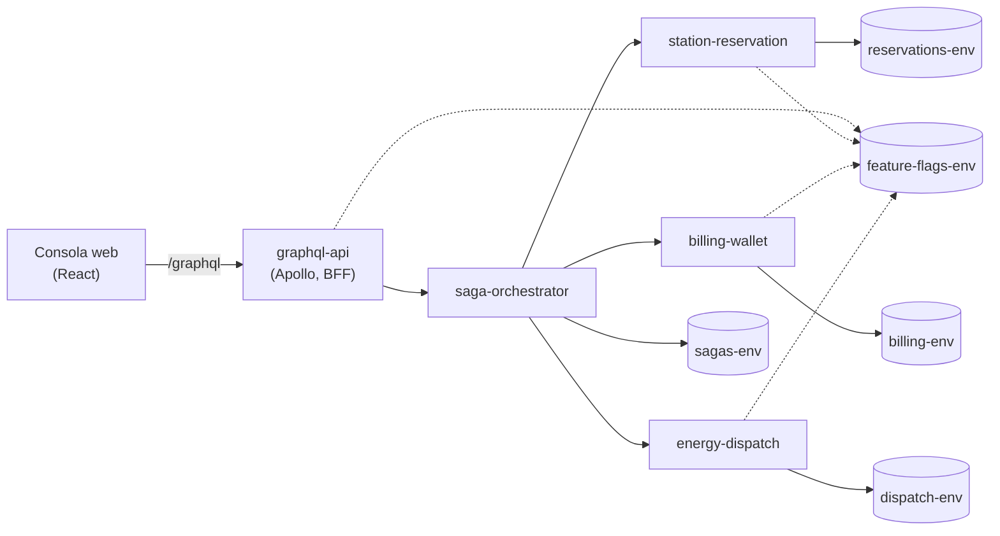

# AegisVolt

Plataforma cloud-native para gestionar la carga de flotas de vehículos eléctricos. Permite reservar un conector, cobrar con el saldo de la flota, activar la carga y auditar la telemetría y las transacciones, con tres ambientes aislados: `dev`, `test` y `prod`.

- **Especificación:** [`proyecto_final.md`](proyecto_final.md).
- **Reglas de trabajo:** [`CLAUDE.md`](CLAUDE.md).
- **Infraestructura:** todo corre contra **Floci**, un emulador local de AWS, con credenciales ficticias. Nada se desplegó en una cuenta AWS real.

## Problema que resuelve

Las empresas de logística que migran a vehículos eléctricos chocan con cuatro problemas:

- conectores de alta potencia muy disputados;
- cobros que quedan inconsistentes cuando un cargador falla después de cobrar;
- poca visibilidad del consumo;
- despliegues de software riesgosos en estaciones activas.

El flujo central, **"Reservar y Activar Carga"**, atraviesa tres servicios con bases de datos propias, así que no puede usar una transacción ACID. AegisVolt lo resuelve con una **SAGA orquestada**: si el cargador falla, se reembolsa el saldo y se libera el conector. Las compensaciones son idempotentes y se recuperan tras reinicios. Además:

- cada ambiente tiene sus propias feature flags, que cambian sin redesplegar;
- las versiones nuevas se publican con despliegues canary analizados con métricas de CloudWatch.

## Arquitectura



- **Entrada:** API Gateway → VPC Link → NLB interno → Traefik → pods del clúster EKS del ambiente.
- **Datos:** una tabla DynamoDB por servicio y por ambiente (`aegisvolt-<dominio>-<env>`). Ningún servicio accede a la tabla de otro.
- **Observabilidad:** logs JSON con `correlation_id` → Fluent Bit → CloudWatch (`/aegisvolt/<env>/<servicio>`). Prefect audita la salud de los ambientes y la consistencia de las SAGAs.

Diagramas de arquitectura, secuencia de la SAGA, despliegue y networking: [docs/architecture/overview.md](docs/architecture/overview.md).

## Stack

| Capa | Tecnología |
| --- | --- |
| Lenguaje | TypeScript estricto sobre Node.js 26. Python 3.12 solo para Prefect |
| Frontend | React 19, Apollo Client 4, Vite |
| API | Apollo Server 5 sobre Express, esquema único (14 queries y 4 mutaciones), JWT de Cognito |
| Microservicios | Express con arquitectura hexagonal; validación con zod; logs con pino |
| Persistencia | Amazon DynamoDB (AWS SDK v3), escrituras condicionales y transacciones |
| SAGA | Orquestada, con estados persistidos, *lease* y recuperación |
| Feature flags | Tabla DynamoDB por ambiente, escritura auditada |
| Contenedores | Docker multi-stage, base fijada por digest, usuario no root, etiqueta `sha-<commit>` |
| Kubernetes | Kustomize (base y overlays por ambiente), NetworkPolicies, Pod Security `restricted` |
| Canary | Argo Rollouts v1.10.1 + Traefik v3.7.16 + análisis en CloudWatch |
| IaC | Terraform 1.17.1, provider AWS 6.71.0, backend S3 versionado con `use_lockfile`, workspaces `dev`/`test`/`prod` |
| Emulación | Floci 2.4.0 (S3, DynamoDB, CloudWatch, API Gateway, ELBv2, EC2/VPC, IAM, Cognito, ECR, EKS como k3s) |
| Observabilidad | CloudWatch Logs y Metrics, Fluent Bit 5.1.5, Prefect 3.9.0 |
| CI/CD | GitHub Actions en runners hospedados, con Floci temporal por ejecución |
| Pruebas | Vitest (unitarias e integración), E2E con los procesos reales y Chromium, pytest |

Las decisiones y sus motivos están en los [ADR](docs/adr/), indexados en [docs/architecture/README.md](docs/architecture/README.md#índice-de-adr).

## Requisitos

| Herramienta | Versión | Para qué |
| --- | --- | --- |
| Node.js | 26 (`.nvmrc`) | Todo el código TypeScript |
| pnpm | 12.18.0 (`packageManager`) | Monorepo |
| Docker Engine + Compose v2 | ≥ 23 (verificado 29.9.3) | Floci, imágenes y k3s |
| AWS CLI v2, Terraform 1.17.1, kubectl, jq | ver la guía de instalación | Infraestructura local |
| Python | 3.12 con `venv` | Prefect |

- `pnpm-workspace.yaml` tiene `engineStrict: true`: la instalación falla con otra versión de Node.
- Un clúster k3s ocupa ~1,3 GB de RAM.

Instalación detallada y problemas frecuentes: [docs/runbooks/installation-troubleshooting.md](docs/runbooks/installation-troubleshooting.md).

## Instalación local

```bash
nvm install && nvm use
npm install -g pnpm@12.18.0
pnpm install
pnpm check            # formato + lint + typecheck + pruebas unitarias + build
```

## Iniciar Floci

```bash
scripts/floci/start.sh          # Floci 2.4.0 en http://localhost:4566 (solo loopback, datos persistentes)
scripts/floci/status.sh
scripts/floci/smoke-test.sh     # S3, DynamoDB, Logs, API Gateway, VPC/VPCE, ECR
scripts/floci/stop.sh           # detiene sin borrar datos
```

Los scripts cargan credenciales ficticias (`test`/`test`), ignoran `~/.aws` y abortan si el endpoint no es local. Runbook: [docs/runbooks/floci.md](docs/runbooks/floci.md).

## Ejecutar los servicios

Hay cuatro modos ([docs/runbooks/local-development.md](docs/runbooks/local-development.md)):

```bash
# A. Procesos Node con recarga (tablas *-local en Floci)
scripts/floci/bootstrap-env.sh local && pnpm dev

# B. Stack de demostración con datos (consola en http://127.0.0.1:24105)
pnpm --filter @aegisvolt/e2e-tests demo:web

# C. Imágenes reales con docker compose (consola en http://127.0.0.1:8080)
scripts/local/compose.sh up && scripts/local/compose.sh seed

# D. Ambiente dev en el EKS (k3s) de Floci, con la infraestructura de Terraform
scripts/floci/terraform-bootstrap.sh apply && scripts/floci/terraform-global.sh apply
scripts/floci/terraform-live.sh dev apply
scripts/floci/k8s-deploy.sh dev && scripts/floci/k8s-verify.sh dev
```

| Ruta | Paquete | Puerto local | Responsabilidad |
| --- | --- | --- | --- |
| `apps/web` | `@aegisvolt/web` | 5173 | Consola (SPA) |
| `apps/graphql-api` | `@aegisvolt/graphql-api` | 4000 | BFF GraphQL ([guía](docs/graphql/README.md)) |
| `services/saga-orchestrator` | `@aegisvolt/saga-orchestrator-service` | 4100 | Orquestador de la SAGA |
| `services/station-reservation` | `@aegisvolt/station-reservation-service` | 4101 | Estaciones, conectores y reservas |
| `services/billing-wallet` | `@aegisvolt/billing-wallet-service` | 4102 | Billeteras, débitos y reembolsos |
| `services/energy-dispatch` | `@aegisvolt/energy-dispatch-service` | 4103 | Activación del cargador y telemetría |
| `packages/{contracts,logger,config,feature-flags}` | `@aegisvolt/*` | — | Contratos HTTP, logger JSON, configuración validada y lector de flags |
| `prefect/` | — | — | Flujos de salud y auditoría (Python, [README](prefect/README.md)) |
| `tests/e2e/` | `@aegisvolt/e2e-tests` | — | E2E con los procesos reales contra Floci |
| `infra/` | — | — | Floci local, Terraform y Kubernetes |
| `.github/workflows/` | — | — | CI/CD ([README](.github/workflows/README.md)) |

Cada servicio sigue la estructura hexagonal `domain/ → application/ → infrastructure/ + presentation/`, con `main.ts` como *composition root*. dependency-cruiser la hace cumplir (`pnpm lint:deps`), e impide que un servicio importe código de otro.

## Frontend

La consola (`apps/web`) solo habla con `/graphql`, en el mismo origen. Tiene seis vistas:

- dashboard;
- estaciones y conectores;
- **Carga**, que dispara la SAGA y muestra su progreso;
- transacciones;
- feature flags del ambiente (los administradores pueden cambiarlas);
- observabilidad (eventos de la SAGA y `correlation_id`).

El login es con Cognito y el ambiente lo informa el backend. Detalle: [apps/web/README.md](apps/web/README.md) y [docs/runbooks/web-console-demo.md](docs/runbooks/web-console-demo.md).

```bash
pnpm --filter @aegisvolt/web dev      # http://localhost:5173 (proxy /graphql → :4000, /auth/cognito → Floci)
```

## Pruebas

| Comando | Qué cubre |
| --- | --- |
| `pnpm test` | Unitarias: dominio, casos de uso, compensaciones de la SAGA y resolvers |
| `REQUIRE_INTEGRATION=true pnpm test:integration` | DynamoDB real en Floci y GraphQL, incluido el aislamiento de flags por ambiente |
| `REQUIRE_INTEGRATION=true pnpm test:e2e` | SAGA con los procesos reales (éxito, fondos insuficientes, falla de hardware, compensación repetida, reinicios), GraphQL con Cognito y consola en Chromium. Evidencia en `tests/e2e/.evidence/` |
| `cd prefect && .venv/bin/pytest` | Reglas y flows de Prefect |
| `pnpm lint` / `pnpm typecheck` / `pnpm build` / `pnpm format:check` | Calidad estática y compilación |
| `pnpm check` | Formato, lint, typecheck, unitarias y build en secuencia |

Sin `REQUIRE_INTEGRATION=true`, las pruebas de integración y E2E se omiten si Floci no responde.

**Resultados de la última auditoría** (2026-11-19, commit `4e6e269`, todos correctos):

- 554 pruebas unitarias, 46 de integración, 19 E2E y 25 de Prefect;
- 6 imágenes construidas;
- planes de Terraform sin cambios en los 5 estados;
- verificaciones de Kubernetes, 17/17;
- verificación de red, 29/29.

No se publican métricas de cobertura. Detalle: [docs/requirements-traceability.md](docs/requirements-traceability.md).

## Lo que está emulado

Floci ejecuta de verdad S3 (versionado y lock del estado), DynamoDB, CloudWatch Logs y metric filters, API Gateway → VPC Link → NLB → k3s, Cognito, ECR y un k3s por clúster EKS.

Solo guarda como **metadatos**, sin aplicarlos:

- el enrutamiento y el filtrado de VPC, subredes, rutas, security groups y VPC Endpoints;
- el aislamiento de la API Gateway PRIVATE;
- el endpoint privado de EKS;
- las políticas IAM.

Localmente solo `dev` tiene clúster, por memoria. Cada limitación y su forma verificable de cumplir el objetivo está en [docs/limitations.md](docs/limitations.md).

## Documentación

| Documento | Contenido |
| --- | --- |
| [Visión general](docs/architecture/overview.md) | Componentes y diagramas Mermaid de arquitectura, SAGA, despliegue y networking |
| [Arquitectura detallada](docs/architecture/README.md) | Dominio, SAGA, flags, red, infraestructura, observabilidad, CI/CD, pruebas e índice de ADR |
| [ADR](docs/adr/) | 36 decisiones numeradas |
| [Trazabilidad de requisitos](docs/requirements-traceability.md) | Estado y evidencia de cada requisito |
| [Guía de sustentación](docs/guia-sustentacion.md) | Respuesta paso a paso a cada pregunta del banco (§6), con comandos y archivos |
| [Limitaciones](docs/limitations.md) | Qué no emula Floci y cómo se cumple de forma verificable |
| [Contratos](docs/contracts/README.md) y [GraphQL](docs/graphql/README.md) | Contratos HTTP entre servicios y uso del API |
| **Runbooks** | |
| [Desarrollo local](docs/runbooks/local-development.md) | Los cuatro modos de ejecución y las pruebas |
| [Instalación y troubleshooting](docs/runbooks/installation-troubleshooting.md) | Herramientas y problemas frecuentes |
| [Floci](docs/runbooks/floci.md) | Operación del emulador y qué emula |
| [Terraform](docs/runbooks/terraform.md) | Bootstrap, workspaces, evidencias, versiones y restauración del estado |
| [Kubernetes](docs/runbooks/kubernetes.md) | Imágenes, compose, despliegue y operación del clúster |
| [Canary y rollback](docs/runbooks/canary-rollback.md) | Promoción, rollback inducido y muestra insuficiente |
| [Observabilidad](docs/runbooks/observability.md) | CloudWatch por `correlation_id`, métricas, alarmas y Prefect |
| [Configuración de GitHub](docs/runbooks/github-repository-settings.md) | Rulesets, environments, Actions y seguridad (manual) |
| [SAGA](docs/runbooks/saga-demo.md), [feature flags](docs/runbooks/feature-flags-demo.md) y [consola web](docs/runbooks/web-console-demo.md) | Demostraciones con evidencia de DynamoDB |
| [Guía de demostración](docs/runbooks/demo.md) | Guion de 20 minutos por capas |
| [Floci: referencia](infra/local/floci/README.md) | Versiones, matriz de servicios verificada |
