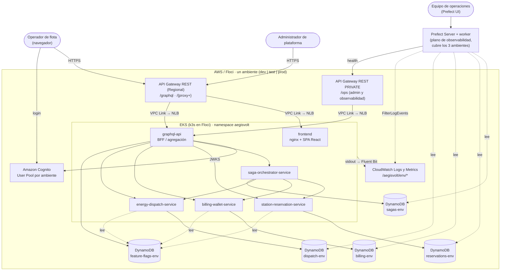
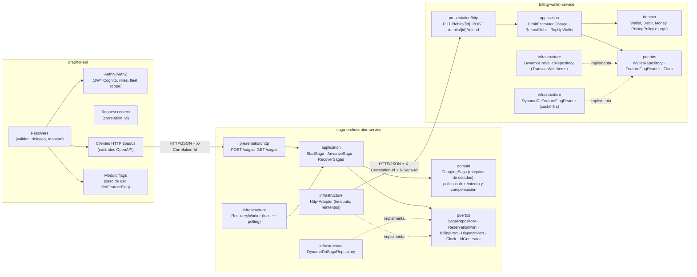

# 01 · Dominio, servicios, contratos y datos

Cubre los puntos 1–6 del diseño. Las decisiones se registran en [ADR-0002](../adr/0002-bounded-contexts-y-orquestador-dedicado.md), [ADR-0004](../adr/0004-comunicacion-sincrona-http-contratos-openapi.md) y [ADR-0006](../adr/0006-dynamodb-single-table-por-servicio.md).

## 1. Componentes y responsabilidades

| Componente | Responsabilidad | Fuera de su alcance |
| --- | --- | --- |
| **Frontend** (`apps/web`) | SPA en React + TypeScript con cuatro vistas obligatorias (§2.1): panel de estaciones y conectores, flujo "Reservar y activar carga", visor de feature flags del ambiente e historial de SAGAs y compensaciones. Habla **solo** con el endpoint GraphQL de su ambiente y refresca los datos por *polling* (ver [ADR-0017](../adr/0017-frontend-spa-mismo-origen-polling.md)). | Reglas de negocio, cálculo de precios, decisiones de estado. |
| **GraphQL API** (`apps/graphql-api`) | Capa de agregación (*BFF*) con un esquema unificado. Autentica el JWT, autoriza (rol y flota), valida la entrada, propaga `correlation_id` y compone respuestas de varios servicios (p. ej. estación + conectores + telemetría). Contiene el módulo administrativo de feature flags. | Orquestar la SAGA, decidir compensaciones, acceder a tablas de negocio. |
| **saga-orchestrator-service** | Dueño del proceso "Reservar y Activar Carga". Mantiene la máquina de estados persistente, ejecuta los pasos y las compensaciones, aplica reintentos y timeouts, y recupera SAGAs tras reinicios. | Reglas internas de cada servicio (disponibilidad, saldo, hardware). |
| **station-reservation-service** | Catálogo de estaciones y conectores. Bloqueo temporal (*hold*) de conectores, confirmación y liberación. Evalúa `ENABLE_FAST_CHARGE_BOOST`. | Precios, cobros, hardware. |
| **billing-wallet-service** | Billeteras de flota, tarifas, cálculo del cargo estimado, débito, reembolso y libro mayor. Evalúa `ENABLE_DYNAMIC_SURGE_PRICING`. | Disponibilidad de conectores, hardware. |
| **energy-dispatch-service** | Sesiones de despacho, orden de activación al cargador a través de un puerto `ChargerAdapter` (adaptador `SimulatedChargerAdapter`), aborto de sesiones y telemetría simulada. Evalúa `SIMULATE_CHARGER_HARDWARE_FAULT`. | Cobros, reservas. |
| **Prefect** (`prefect/`, Python) | Flujos de salud de los tres ambientes y auditoría de consistencia de SAGAs (lectura). | Escribir en tablas de negocio. |

> La especificación pide "mínimo tres" microservicios. El orquestador es un cuarto servicio desplegable; la justificación está en [ADR-0002](../adr/0002-bounded-contexts-y-orquestador-dedicado.md) y en [09-analisis-especificacion.md](09-analisis-especificacion.md) (P-17).

## 2. Bounded contexts y ownership de datos

| Bounded context | Tipo de subdominio | Servicio dueño | Datos que posee (único escritor) | Lenguaje ubicuo |
| --- | --- | --- | --- | --- |
| **Charging Orchestration** | Core | saga-orchestrator-service | `aegisvolt-sagas-<env>` | SAGA, paso, compensación, pivote |
| **Station Reservation** | Core | station-reservation-service | `aegisvolt-reservations-<env>` | Estación, conector, *hold*, reserva |
| **Billing & Wallet** | Core | billing-wallet-service | `aegisvolt-billing-<env>` | Billetera, débito, reembolso, tarifa, *surge* |
| **Energy Dispatch** | Core | energy-dispatch-service | `aegisvolt-dispatch-<env>` | Sesión de despacho, cargador, falla, telemetría |
| **Platform Configuration** (flags) | Genérico | GraphQL API (módulo `flags`) | `aegisvolt-feature-flags-<env>` | Flag, ambiente, auditoría |
| **Identity** | Genérico | Amazon Cognito (gestionado) | User Pool por ambiente | Usuario, grupo, flota |

Reglas:
- Cada tabla tiene **un solo servicio escritor**, y la IAM de cada servicio solo le permite acceder a su tabla ([ADR-0006](../adr/0006-dynamodb-single-table-por-servicio.md)).
- Hay dos excepciones de **solo lectura**, explícitas y justificadas:
  - Los servicios leen `feature-flags-<env>` a través de la librería `packages/feature-flags` ([ADR-0007](../adr/0007-feature-flags-dynamodb-por-ambiente.md)).
  - Prefect lee las tablas de negocio para auditar, como exige §2.5 ([ADR-0014](../adr/0014-observabilidad-cloudwatch-fluent-bit-prefect.md)).
- Ningún servicio comparte modelos de persistencia. Los identificadores de otros contextos (`fleetId`, `stationId`, `sagaId`) viajan como valores opacos.

## Diagrama de contexto y contenedores



## Diagrama de componentes (vista hexagonal)

El mismo patrón se repite en los tres servicios de dominio. Se muestran el orquestador y `billing-wallet-service` como ejemplos.



## 3. Responsabilidad del GraphQL API frente al SAGA Orchestrator

| Aspecto | GraphQL API | SAGA Orchestrator |
| --- | --- | --- |
| Rol | Borde de la aplicación: un esquema único para el frontend | Coordinador del proceso distribuido |
| Estado | Sin estado de negocio (solo el módulo de flags) | Estado persistente de cada SAGA |
| Lógica | Autenticación, autorización, validación, composición de lecturas | Secuencia de pasos, decisión de compensar, reintentos, recuperación |
| Mutación `reserveAndStartCharging` | Valida la entrada y la flota del usuario, y llama `POST /sagas` con `idempotencyKey` | Crea la SAGA, la ejecuta y devuelve su estado |
| Fallos | Traduce errores a `errors[].extensions.code` | Decide entre `COMPLETED`, `COMPENSATED`, `FAILED` y `COMPENSATION_FAILED` (recuperable) |

Esquema GraphQL orientativo (la versión definitiva se fija al implementar):

```graphql
type Query {
  environment: EnvironmentInfo!                 # dev | test | prod, versión desplegada
  stations(city: String): [Station!]!
  station(id: ID!): Station
  telemetry(sessionId: ID!, limit: Int = 50): [TelemetryPoint!]!
  wallet(fleetId: ID!): Wallet!                 # con transactions(limit)
  saga(id: ID!): ChargingSaga
  sagas(fleetId: ID!, status: SagaStatus, limit: Int = 20): [ChargingSaga!]!
  featureFlags: [FeatureFlag!]!
}

type Mutation {
  reserveAndStartCharging(input: ReserveAndStartChargingInput!): ChargingSagaPayload!   # dispara la SAGA
  topUpWallet(input: TopUpWalletInput!): Wallet!                                        # "pagos"; rol admin
  setFeatureFlag(key: FeatureFlagKey!, enabled: Boolean!): FeatureFlag!                 # rol admin
}

input ReserveAndStartChargingInput {
  fleetId: ID!  stationId: ID!  connectorId: ID!
  requestedEnergyKwh: Float!  fastChargeBoost: Boolean = false
  idempotencyKey: ID!                            # UUID generado por el cliente en cada acción del usuario
}
```

No se exponen mutaciones sueltas como "reservar" o "cobrar". Así nadie puede saltarse la SAGA y dejar estados inconsistentes (ver P-12 en [09](09-analisis-especificacion.md)).

## 4. Comunicación síncrona, contratos y timeouts

- **Protocolo:** HTTP/1.1 con JSON entre pods, usando Services `ClusterIP`. Los errores siguen RFC 9457 (`application/problem+json` con `code`, `detail` y `correlationId`).
- **Contratos:** la fuente de verdad son los **esquemas Zod versionados** de `packages/contracts` ([ADR-0020](../adr/0020-modelos-de-dominio-y-contratos-zod.md)). El proveedor los usa para validar peticiones y los consumidores (GraphQL API y orquestador) para validar respuestas. La especificación completa (rutas, cuerpos, errores y versiones) está en [docs/contracts](../contracts/README.md).
- **Cabeceras obligatorias:** `x-correlation-id` y, en las llamadas de la SAGA, `x-saga-id`. `idempotency-key` solo se usa en `POST /v1/sagas`; el resto de operaciones de la SAGA son `PUT` idempotentes por ID.

### Contratos principales (resumen de v1)

Todas las rutas llevan el prefijo de versión `/v1`.

| Servicio | Operación | Respuestas de negocio |
| --- | --- | --- |
| reservation | `PUT /v1/reservations/{reservationId}` `{sagaId, fleetId, stationId, connectorId, fastChargeBoost}`; la duración del *hold* la decide el servicio | `201`/`200` HELD · `409 CONNECTOR_UNAVAILABLE` · `409 ULTRA_FAST_REQUIRES_BOOST` · `409 RESERVATION_CANCELLED` (tombstone) · `403 FAST_CHARGE_BOOST_DISABLED` · `404` |
| reservation | `POST /v1/reservations/{id}/confirm` | `200 CONFIRMED` · `409 RESERVATION_NOT_HELD` / `RESERVATION_HOLD_EXPIRED` |
| reservation | `POST /v1/reservations/{id}/release` `{reason}` | `200 RELEASED` / `ALREADY_RELEASED` / `VOIDED` (crea un tombstone si no existía) |
| reservation | `GET /v1/stations?city=`, `GET /v1/stations/{id}` | lecturas |
| billing | `PUT /v1/debits/{debitId}` `{sagaId, fleetId, energyKwh, connectorPowerKw}` | `201`/`200` DEBITED `{amount, pricing}` · `422 INSUFFICIENT_FUNDS` · `409 DEBIT_VOIDED` |
| billing | `POST /v1/debits/{id}/refund` `{reason}` | `200 REFUNDED` / `ALREADY_REFUNDED` / `NOTHING_TO_REFUND` / `VOIDED` |
| billing | `GET /v1/wallets/{fleetId}`, `GET /v1/wallets/{fleetId}/transactions`, `PUT /v1/wallets/{fleetId}/top-ups/{topUpId}` | lecturas / recarga |
| dispatch | `PUT /v1/sessions/{sessionId}` `{sagaId, stationId, connectorId, energyKwh}` | `201`/`200` ACTIVE · `422 CHARGER_HARDWARE_FAULT {faultCode, simulated}` · `409 SESSION_ABORTED` |
| dispatch | `POST /v1/sessions/{id}/abort`, `GET /v1/sessions/{id}`, `GET /v1/sessions/{id}/telemetry` | `200 ABORTED` / `ALREADY_ABORTED` / `ALREADY_FAILED` / `VOIDED` · `409 SESSION_ALREADY_COMPLETED` |
| orchestrator | `POST /v1/sagas` (`idempotency-key`), `GET /v1/sagas/{id}`, `GET /v1/sagas/{id}/events`, `GET /v1/sagas?fleetId&status&limit` | `201` terminal · `202` en curso · `409 IDEMPOTENCY_KEY_CONFLICT` |

### Presupuesto de timeouts

El límite lo pone la integración de API Gateway REST: **29 s** por defecto. Cada capa interna usa un presupuesto menor que la capa que la llama, para no multiplicar reintentos entre capas.

| Llamada | Timeout por intento | Reintentos | Peor caso |
| --- | --- | --- | --- |
| Frontend → API Gateway → GraphQL | 29 s (límite de API Gateway) | 0 (lo decide el usuario; la idempotencia lo hace seguro) | 29 s |
| GraphQL → `POST /sagas` | 12 s | 0 | 12 s |
| Orquestador: espera síncrona de la SAGA | `SAGA_SYNC_WAIT_MS` = 8 s; después responde `202` y la SAGA continúa en segundo plano | — | 8 s |
| Orquestador → servicio (por paso) | 2 s | 2 (3 intentos), backoff exponencial 200 ms × 2ⁿ con jitter | ~6,6 s |
| Servicio → DynamoDB (SDK v3) | 1 s de conexión y 2 s de solicitud | `maxAttempts: 2` | ~4 s |
| GraphQL → servicios (lecturas) | 2 s | 1 reintento solo en `GET` | ~4,2 s |

Solo se reintenta ante errores de red, timeouts, `5xx` o `429`. **Nunca** ante respuestas de negocio (`409`, `422`, `403`, `404`), que son definitivas. No se usa *circuit breaker*: con este volumen y presupuestos acotados sería un patrón artificial (regla 10). Queda como evolución si las métricas lo justifican.

## 5. Database-per-Service

| Tabla (por ambiente) | Servicio | Acceso IAM |
| --- | --- | --- |
| `aegisvolt-sagas-<env>` | saga-orchestrator-service | RW solo el orquestador. Prefect: R |
| `aegisvolt-reservations-<env>` | station-reservation-service | RW solo reservation. Prefect: R |
| `aegisvolt-billing-<env>` | billing-wallet-service | RW solo billing. Prefect: R |
| `aegisvolt-dispatch-<env>` | energy-dispatch-service | RW solo dispatch. Prefect: R |
| `aegisvolt-feature-flags-<env>` | GraphQL API (módulo flags) | RW GraphQL. Servicios: R |

Todas las tablas usan `PAY_PER_REQUEST`, *Point-in-Time Recovery* y, en `prod`, `deletion_protection_enabled`; el soporte de estas dos opciones en Floci está pendiente de verificar en la fase de IaC. Los nombres se derivan de `terraform.workspace`.

## 6. Modelo de datos e índices

Notación: `PK`/`SK` son la clave primaria y `GSIn` los índices secundarios globales. Los importes se guardan como **enteros en unidades menores** (`amountMinor`, p. ej. centavos de COP) para evitar errores de coma flotante. Todas las entidades llevan `version` (concurrencia optimista), `createdAt` y `updatedAt`.

### `aegisvolt-sagas-<env>` (orquestador)

| Entidad | PK | SK | Atributos clave | GSI1 (por flota) | GSI2 (por estado) |
| --- | --- | --- | --- | --- | --- |
| Saga | `SAGA#<sagaId>` | `META` | `status`, `fleetId`, `stationId`, `connectorId`, `requestedEnergyKwh`, `fastChargeBoost`, `reservationId`, `debitId`, `sessionId`, `steps` (mapa paso → `{status, attempts, lastError, at}`), `correlationId`, `failureReason`, `nextAttemptAt`, `leaseOwner`, `leaseExpiresAt`, `version` | `FLEET#<fleetId>` / `<createdAt>#<sagaId>` | `STATUS#<status>` / `<updatedAt>#<sagaId>` |
| SagaEvent | `SAGA#<sagaId>` | `EVT#<ts>#<seq>` | `type` (`STEP_STARTED`, `STEP_SUCCEEDED`, `STEP_FAILED`, `COMPENSATION_*`, `RECOVERED`), `step`, `detail`, `correlationId` | — | — |
| Idempotency | `IDEM#<fleetId>#<idempotencyKey>` | `META` | `sagaId`, `requestHash`, `ttl` | — | — |

- Saga y SagaEvent se escriben juntas con `TransactWriteItems`, con la condición `version = :expected`. Así el historial nunca diverge del estado.
- GSI2 permite al *RecoveryWorker* consultar los estados no terminales, y a Prefect contar SAGAs por estado.

### `aegisvolt-reservations-<env>`

| Entidad | PK | SK | Atributos clave | GSI1 (por ciudad) |
| --- | --- | --- | --- | --- |
| Station | `STATION#<stationId>` | `META` | `name`, `city`, `location`, `operator` | `CITY#<city>` / `STATION#<id>` |
| Connector | `STATION#<stationId>` | `CONN#<connectorId>` | `status` (`AVAILABLE` \| `RESERVED` \| `OUT_OF_SERVICE`), `type`, `maxPowerKw`, `ultraFast`, `currentReservationId`, `holdExpiresAt`, `version` | `CITY#<city>` / `STATION#<id>#CONN#<id>` |
| Reservation | `RES#<reservationId>` | `META` | `sagaId`, `fleetId`, `stationId`, `connectorId`, `status` (`HELD` \| `CONFIRMED` \| `RELEASED` \| `EXPIRED` \| `VOIDED`), `holdExpiresAt` | — |

- `PUT /reservations/{id}` usa una transacción: actualiza el conector con la condición `status = AVAILABLE OR (status = RESERVED AND holdExpiresAt < :now AND currentReservation está HELD)` y crea la reserva con `attribute_not_exists(PK)`.
- El *hold* vence de forma perezosa (*lazy*). No se depende del TTL de DynamoDB, que no garantiza borrado inmediato.
- GSI1 devuelve en una sola consulta todas las estaciones y conectores de una ciudad, que es lo que necesita el panel.

### `aegisvolt-billing-<env>`

| Entidad | PK | SK | Atributos clave | GSI1 (por saga) |
| --- | --- | --- | --- | --- |
| Wallet | `WALLET#<fleetId>` | `META` | `balanceMinor`, `currency`, `version` | — |
| LedgerEntry | `WALLET#<fleetId>` | `TX#<ts>#<txId>` | `type` (`DEBIT` \| `REFUND` \| `TOP_UP`), `amountMinor`, `balanceAfterMinor`, `sagaId`, `debitId`, `correlationId` | `SAGA#<sagaId>` / `TX#<ts>` |
| Debit | `DEBIT#<debitId>` | `META` | `status` (`DEBITED` \| `REFUNDED` \| `REJECTED_INSUFFICIENT_FUNDS` \| `VOIDED`), `fleetId`, `amountMinor`, `tariffMinorPerKwh`, `surgeMultiplier`, `sagaId` | `SAGA#<sagaId>` / `DEBIT` |
| Tariff | `TARIFF#<powerClass>` | `META` | `minorPerKwh`, `surgeMultiplier`, `peakWindows` | — |

- El débito es una transacción de tres escrituras: wallet con `balanceMinor >= :amount AND version = :v`, debit con `attribute_not_exists(PK)` y entrada del libro mayor.
- Si el saldo no alcanza, se registra el Debit como `REJECTED_INSUFFICIENT_FUNDS`. Un reintento con el mismo ID devuelve la misma respuesta `422`, lo que hace idempotente también el rechazo.

### `aegisvolt-dispatch-<env>`

| Entidad | PK | SK | Atributos clave | GSI1 (por conector) |
| --- | --- | --- | --- | --- |
| DispatchSession | `SESSION#<sessionId>` | `META` | `sagaId`, `stationId`, `connectorId`, `status` (`ACTIVE` \| `FAILED` \| `ABORTED` \| `VOIDED` \| `COMPLETED`), `faultCode`, `simulatedFault` | `CONN#<stationId>#<connectorId>` / `<startedAt>` |
| TelemetryPoint | `SESSION#<sessionId>` | `TEL#<ts>` | `powerKw`, `energyKwh`, `voltage`, `temperatureC`, `ttl` | — |

### `aegisvolt-feature-flags-<env>`

| Entidad | PK | SK | Atributos |
| --- | --- | --- | --- |
| Flag | `FLAG#<key>` | `META` | `enabled`, `description`, `owner`, `version`, `updatedBy`, `updatedAt` |
| FlagAudit | `FLAG#<key>` | `AUDIT#<ts>` | `from`, `to`, `updatedBy`, `correlationId` |

El ambiente se determina por el **nombre de la tabla**. No hace falta un atributo `env`, porque las tablas de cada ambiente no se comparten.
