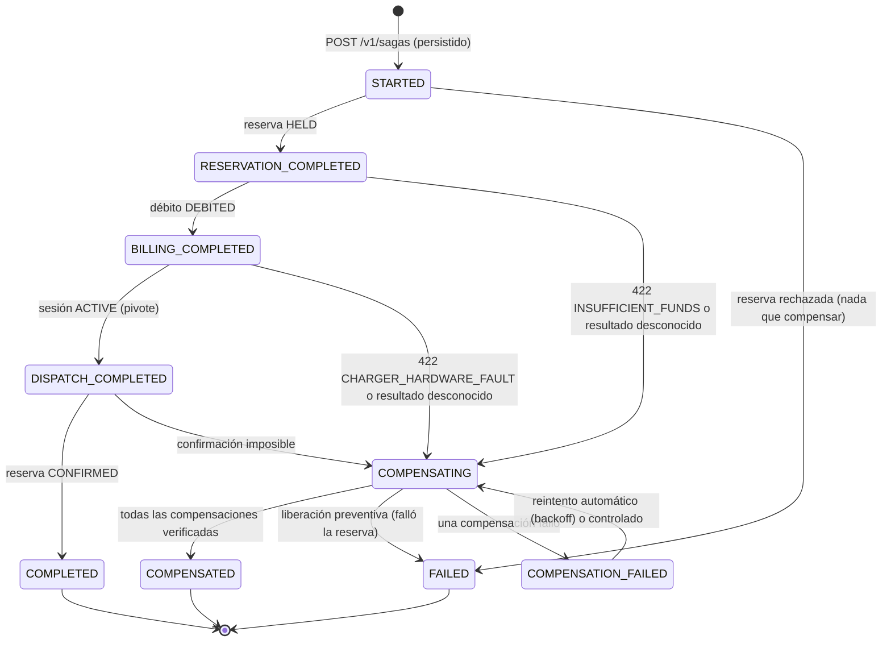
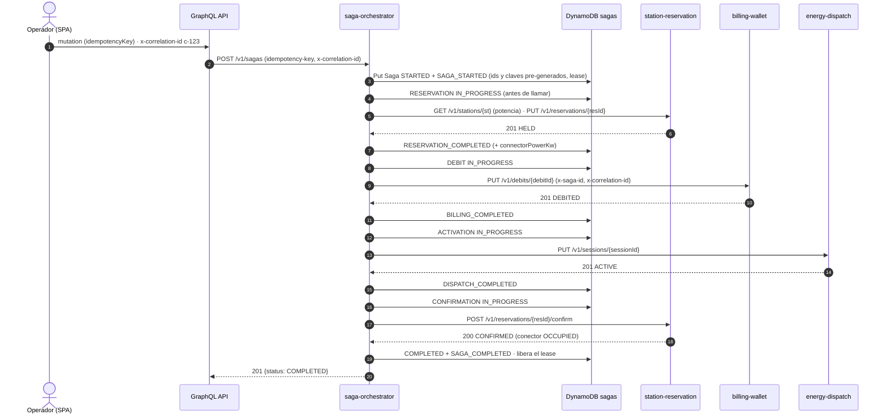
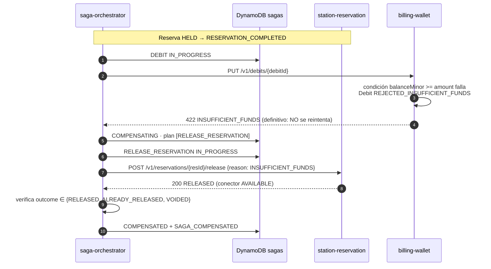
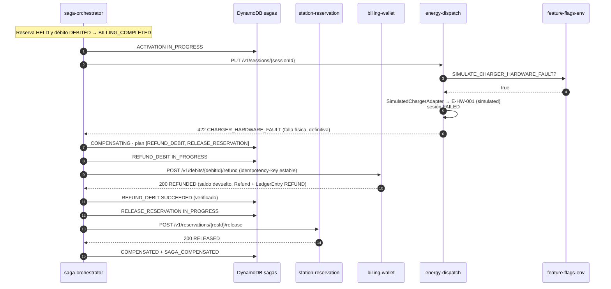
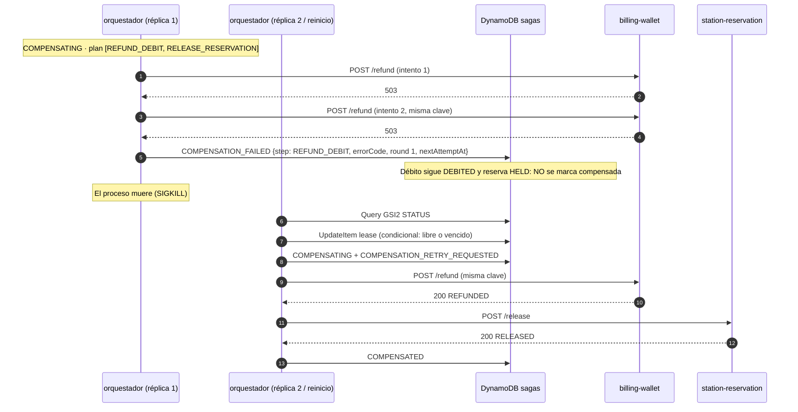
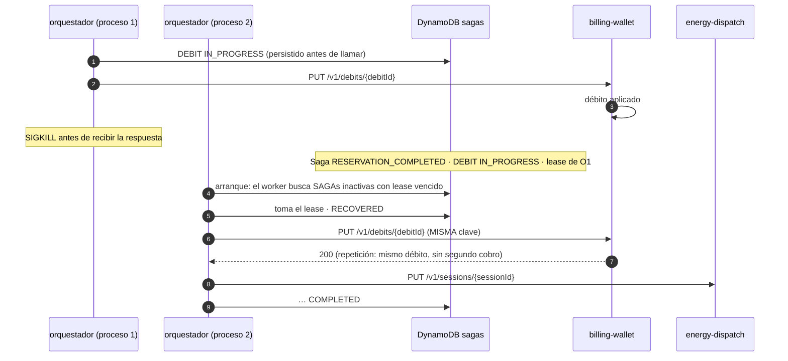

# 02 · SAGA "Reservar y Activar Carga"

Cubre los puntos 7, 8, 9 y 12. Decisiones: [ADR-0003](../adr/0003-saga-orquestada-maquina-estados-persistente.md), [ADR-0005](../adr/0005-idempotencia-ids-pregenerados-y-tombstones.md), [ADR-0009](../adr/0009-propagacion-correlation-id-y-saga-id.md) y [ADR-0024](../adr/0024-saga-orquestada-implementacion-estados-lease-recuperacion.md) (implementación y vocabulario de estados vigente).

> **No es una transacción ACID.** Cada servicio confirma su paso en su propia base de datos. Si un paso posterior falla, el orquestador ejecuta **compensaciones**: operaciones de negocio inversas (liberar, reembolsar, abortar), idempotentes y verificadas. Durante un tiempo el sistema es inconsistente de forma visible y controlada (p. ej. una reserva retenida mientras se cobra). Hablamos de *compensación*, nunca de *rollback*.

## 7. Máquina de estados persistente

Al crear la SAGA, el orquestador **pre-genera y persiste**, antes de llamar a ningún servicio:
- `sagaId`, derivado de la `idempotency-key` de la petición (`saga_<clave>`);
- `reservationId`, `debitId` y `sessionId`;
- las claves idempotentes de la confirmación y de cada compensación;
- el `correlation_id` de la petición.

Aunque una respuesta se pierda o el proceso muera, el orquestador sabe qué recurso tiene que confirmar o compensar y con qué clave.

| Estado | Terminal | Significado |
| --- | --- | --- |
| `STARTED` | No | SAGA persistida; reserva pendiente |
| `RESERVATION_COMPLETED` | No | Conector retenido (`HELD`); débito pendiente |
| `BILLING_COMPLETED` | No | Saldo debitado; activación pendiente |
| `DISPATCH_COMPLETED` | No | Carga activa (pivote superado); confirmación de la reserva pendiente |
| `COMPLETED` | Sí | Carga activa y reserva `CONFIRMED` (conector `OCCUPIED`) |
| `COMPENSATING` | No | Ejecutando el plan de compensación en orden |
| `COMPENSATED` | Sí | Todas las compensaciones del plan **verificadas** por los servicios. No es un error técnico |
| `FAILED` | Sí | Falló la reserva: no hubo efectos que revertir |
| `COMPENSATION_FAILED` | No | Una compensación falló. Guarda paso, error, ronda y `nextAttemptAt`. Lo retoma el worker o un reintento controlado |

El paso **en curso** no es un estado: está en `steps[paso].status = IN_PROGRESS`, y se persiste *antes* de cada llamada.

**Plan de compensación** (orden inverso al avance; solo lo necesario):

| Paso que falla | Rechazo de negocio (sin efecto) | Resultado desconocido | Estado final |
| --- | --- | --- | --- |
| Reserva | — | `release` (preventivo, deja tombstone) | `FAILED` |
| Débito | `release` | `refund` → `release` | `COMPENSATED` |
| Activación | `refund` → `release` | `abort` → `refund` → `release` | `COMPENSATED` |
| Confirmación | `abort` → `refund` → `release` | igual | `COMPENSATED` |

- Para la activación, el enunciado fija "reembolso → liberación".
- Si el resultado de la activación es desconocido, primero se consulta `GET /sessions/{id}`:
  - `ACTIVE` → la SAGA sigue;
  - `FAILED` → se trata como falla física;
  - en otro caso se añade `abort`, que deja un tombstone (P-09).

Cada transición es un `TransactWriteItems`: el ítem Saga (condicionado a `version` y al dueño del *lease*) más sus `SagaEvent` nuevos. El historial nunca diverge del estado.

## Secuencia: SAGA exitosa

## Secuencia: fondos insuficientes

## Secuencia: fallo de hardware (flag `SIMULATE_CHARGER_HARDWARE_FAULT`)

## Secuencia: fallo durante la compensación y recuperación

Un error **no recuperable** (p. ej. `409 RESERVATION_MISMATCH` o una respuesta que no verifica la compensación) deja `COMPENSATION_FAILED` **sin** `nextAttemptAt`. Solo lo retoma un reintento controlado: `POST /v1/sagas/{id}/compensation/retry` o `pnpm saga:recover --retry <sagaId>`.

## Secuencia: reinicio con un paso intermedio persistido

La evidencia real de DynamoDB (Floci) de estos escenarios está en el [runbook de la demostración](../runbooks/saga-demo.md).

## 8. Idempotencia, reintentos, timeouts y compensaciones

| Mecanismo | Implementación | Qué garantiza |
| --- | --- | --- |
| Petición inicial repetida (doble clic, reintento del cliente) | `sagaId = saga_<idempotency-key>`, creada con `attribute_not_exists`. La misma clave con otro cuerpo → `409 IDEMPOTENCY_KEY_CONFLICT` | Una sola SAGA por acción del usuario. La repetición devuelve la misma SAGA y, si quedó a medias y nadie la ejecuta, la reanuda |
| Paso de avance repetido | `PUT` con id pre-generado (`res_`, `dbt_`, `ses_`): mismo cuerpo → `200` con el mismo resultado | Reintentar tras un timeout o un reinicio no duplica reservas, débitos ni sesiones |
| Compensación repetida (§6.3) | Clave estable por compensación, persistida en la SAGA. Cada servicio la resuelve con una transición condicional (`refund` solo si `DEBITED`…) → `ALREADY_*` | Reembolsar o liberar dos veces es imposible. La segunda vez se verifica igual |
| Compensación antes del avance | El recurso inexistente queda como **tombstone** (`VOIDED`); un `PUT` tardío → `409` | Un avance tardío no deja un bloqueo ni un cobro huérfano |
| Compensación verificada | `COMPENSATED` solo si cada respuesta cumple el contrato y su `outcome` está en el conjunto aceptado (`RELEASED`/`ALREADY_RELEASED`/`VOIDED`, `REFUNDED`/`ALREADY_REFUNDED`/`NOTHING_TO_REFUND`/`VOIDED`, `ABORTED`/`ALREADY_*`/`VOIDED`) | Nunca se declara compensado lo que no se confirmó (`UNVERIFIED_COMPENSATION`) |
| Ejecución concurrente de la misma SAGA | *Lease* condicional (`leaseOwner`, `leaseExpiresAt`) más `version`. Cada escritura exige `version = :leída AND leaseOwner = :yo` | Solo una réplica avanza la SAGA. Si pierde el *lease*, la siguiente escritura falla y se detiene |

**Timeouts y reintentos** (configurables, ver el [README del orquestador](../../services/saga-orchestrator/README.md)):

- **Llamadas:** timeout por llamada `SAGA_STEP_TIMEOUT_MS` (3 s). Solo son reintentables red, timeout, 5xx, 408 y 429. Un 4xx de negocio es definitivo y no se reintenta nunca.
- **Avance:** 3 intentos con backoff exponencial y *jitter* (200 ms → 2 s). Si se agotan, el resultado es desconocido y se compensa (en la activación, después de consultar la sesión).
- **Compensaciones:** 3 intentos inmediatos por ronda. Si se agotan:
  - `COMPENSATION_FAILED` con `nextAttemptAt`;
  - hasta 10 rondas automáticas con backoff (5 s → 15 min);
  - después, solo reintento controlado.
- **Errores no recuperables de una compensación:** no programan rondas automáticas.
- **Lease** (30 s): cubre el tramo más largo sin escribir (dos llamadas más un backoff) y se renueva en cada escritura.

## 9. Recuperación ante reinicio del orquestador

`RecoverPendingSagas` corre de tres formas:
- como **worker** en cada réplica: al arrancar y cada `RECOVERY_INTERVAL_MS` (10 s);
- como **tarea controlada** (`pnpm saga:recover`, apta para un CronJob o Job de Kubernetes);
- para una SAGA concreta (`--retry <sagaId>`).

Pasos:
1. Consulta GSI2 (`STATUS#<estado>`) para cada estado no terminal.
2. Selecciona:
   - las SAGAs de avance o compensación sin actividad en `RECOVERY_STALE_AFTER_MS` (15 s);
   - las `COMPENSATION_FAILED` cuyo `nextAttemptAt` venció.
3. **Toma el lease** con una actualización condicional (libre, vencido o propio). Si falla, otra réplica la tiene.
4. Registra `RECOVERED` (o `COMPENSATION_RETRY_REQUESTED`). Si la SAGA está antes del pivote y supera `SAGA_FORWARD_DEADLINE_MS` (60 s, menos que el *hold* de 120 s), **abandona el paso y compensa** en vez de activar una carga tardía.
5. Ejecuta desde el último estado persistido. Un paso `IN_PROGRESS` se repite con la misma clave idempotente.

Red de seguridad independiente del orquestador: el *hold* de la reserva vence solo. Prefect reportará las SAGAs que lleven tiempo en `COMPENSATION_FAILED` o sin avanzar.

## 12. Propagación de `correlation_id` y `saga_id`

| Identificador | Origen | Transporte | Dónde queda |
| --- | --- | --- | --- |
| `correlation_id` | Lo genera el GraphQL API por request. Si el cliente envía `X-Correlation-Id` como UUID válido, se reutiliza. Queda **fijado en la SAGA** al crearla | Cabecera `x-correlation-id` en cada llamada HTTP del orquestador, también en la recuperación | Todos los logs, `Saga.correlationId`, `SagaEvent`, `LedgerEntry`, `FlagAudit` |
| `saga_id` | Lo genera el orquestador al crear la SAGA (`saga_<idempotency-key>`) | Cabecera `x-saga-id` hacia los servicios; también va en el cuerpo de los `PUT` | Logs de los cuatro servicios, ítems de reserva, débito y sesión |
| `idempotency-key` del paso | La SAGA (persistida) | Id del recurso en la ruta, o cabecera `idempotency-key` en la confirmación y las compensaciones | Vista de la SAGA (`steps[].idempotencyKey`) |
| `request_id` de API Gateway | API Gateway | `x-amzn-RequestId` | Logs del GraphQL API |

- En Node.js el contexto viaja con `AsyncLocalStorage`, y el logger lo añade sin pasarlo a mano.
- El observador de la SAGA registra cada evento con el `correlation_id` **original**, también cuando la retoma otra réplica. Una búsqueda en CloudWatch (`{ $.correlation_id = "c-123" }`) devuelve el recorrido completo de los cuatro servicios (verificado en la E2E).
