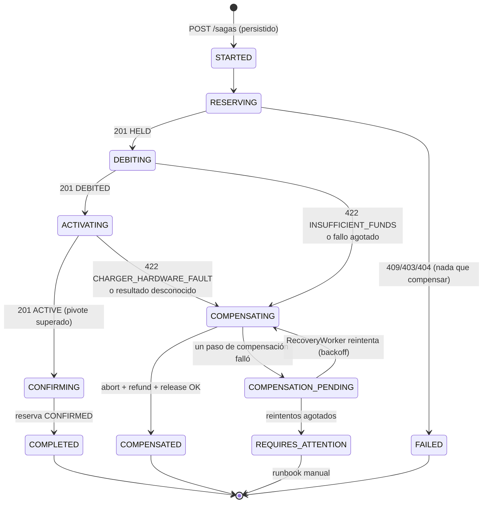
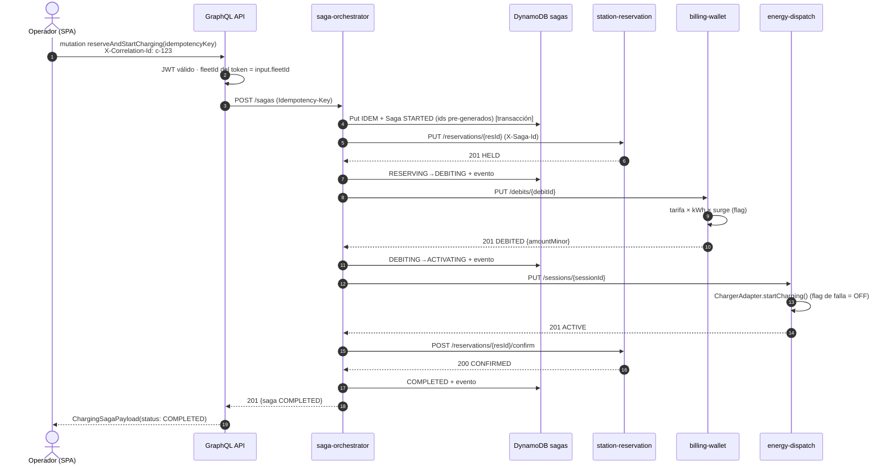
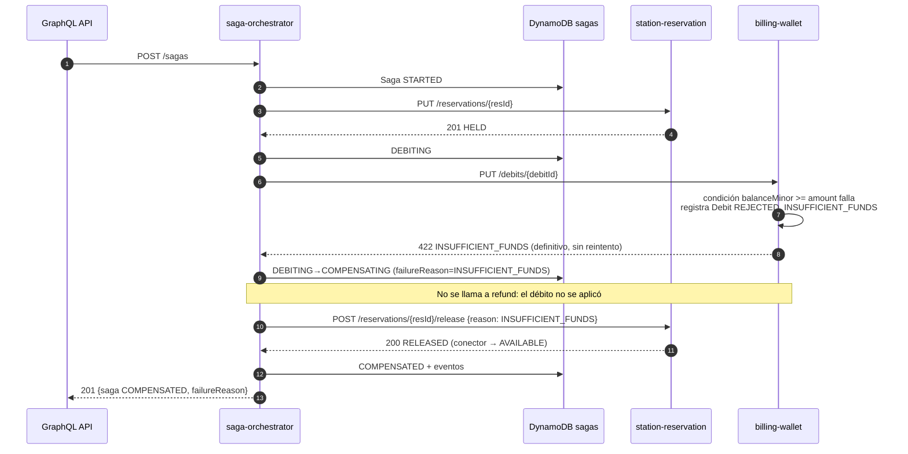
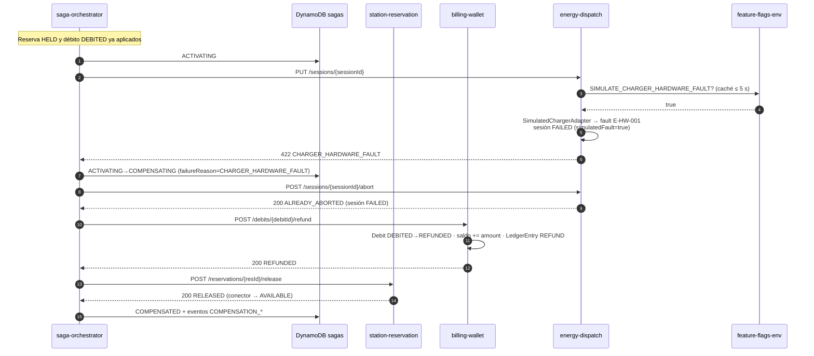

# 02 · SAGA "Reservar y Activar Carga"

Cubre los puntos 7, 8, 9 y 12. Decisiones: [ADR-0003](../adr/0003-saga-orquestada-maquina-estados-persistente.md), [ADR-0005](../adr/0005-idempotencia-ids-pregenerados-y-tombstones.md) y [ADR-0009](../adr/0009-propagacion-correlation-id-y-saga-id.md).

## 7. Máquina de estados persistente

El orquestador **pre-genera** `sagaId`, `reservationId`, `debitId` y `sessionId` al crear la SAGA y los persiste antes de llamar a ningún servicio. Así, aunque una respuesta se pierda, el orquestador sabe qué recurso tiene que confirmar o compensar.

| Estado | Terminal | Significado |
| --- | --- | --- |
| `STARTED`, `RESERVING`, `DEBITING`, `ACTIVATING`, `CONFIRMING` | No | Avance. `RecoveryWorker` los recupera si quedan huérfanos. |
| `COMPENSATING`, `COMPENSATION_PENDING` | No | Deshaciendo pasos en orden inverso. |
| `COMPLETED` | Sí | Carga activa y reserva confirmada. |
| `COMPENSATED` | Sí | Fallo de negocio o técnico con todos los efectos revertidos. **No es un error técnico.** |
| `FAILED` | Sí | Falló el primer paso: no hubo efectos que revertir. |
| `REQUIRES_ATTENTION` | Sí | Compensación imposible tras N intentos. Prefect lo reporta y hay un runbook manual. |

Orden de compensación (inverso al avance):
1. `abort` de la sesión, solo si se llegó a `ACTIVATING`.
2. `refund` del débito, si se llegó a `DEBITING`.
3. `release` de la reserva.

La especificación fija "reembolso → liberación"; el paso 1 se añade para cubrir el caso en que el cargador sí se activó, pero su respuesta se perdió (P-09 en [09](09-analisis-especificacion.md)).

`CONFIRMING` cambia la reserva de `HELD` a `CONFIRMED` para que el *hold* temporal no venza mientras la carga está en curso.

Cada transición se escribe con `TransactWriteItems`: el ítem Saga se actualiza con la condición `version = :expected` y en la misma transacción se inserta un `SagaEvent`. El historial de compensaciones que muestra el frontend (§2.1.4) sale de esos eventos.

## Secuencia: SAGA exitosa

## Secuencia: compensación por fondos insuficientes

## Secuencia: compensación por fallo de hardware

Para la demostración de §6.3 en `test`: se activa la flag, se dispara la mutación y se inspeccionan con `aws dynamodb` el Debit (`REFUNDED`), la entrada de libro mayor `REFUND`, la Reservation (`RELEASED`), el Connector (`AVAILABLE`) y los `SagaEvent`.

## 8. Idempotencia, reintentos, timeouts y compensaciones

| Mecanismo | Implementación | Qué garantiza |
| --- | --- | --- |
| Mutación repetida (doble clic, reintento del cliente) | `idempotencyKey` → ítem `IDEM#<fleetId>#<key>` con `attribute_not_exists` | Una sola SAGA por acción del usuario; la segunda llamada devuelve la misma SAGA. |
| Paso de avance repetido | `PUT` sobre un recurso con ID pre-generado y `attribute_not_exists(PK)`; si existe con el mismo payload → `200` con el mismo resultado; si difiere → `409` | Reintentar después de un timeout no duplica reservas, débitos ni sesiones. |
| Compensación repetida (§6.3: "procesada dos veces") | Transición condicional: `refund` solo si `status = DEBITED`; si ya está `REFUNDED` → `200 ALREADY_REFUNDED` sin tocar el saldo | El reembolso doble es imposible: la condición de DynamoDB lo impide de forma atómica. |
| Compensación que llega **antes** que el avance (reordenamiento tras un timeout) | Si el recurso no existe, la compensación escribe un **tombstone** (`VOIDED`); un `PUT` posterior con ese ID responde `409 *_VOIDED/CANCELLED` | Un avance tardío no puede dejar un bloqueo o un cobro huérfano. |
| Rechazo de negocio repetido | El Debit `REJECTED_INSUFFICIENT_FUNDS` se persiste | El mismo ID devuelve la misma respuesta `422`, con un resultado determinista. |
| Concurrencia sobre la misma SAGA | `version` optimista + *lease* (`leaseOwner`, `leaseExpiresAt`) | Solo una réplica del orquestador avanza la SAGA, incluidos los pods canary. |
| Dos SAGAs sobre el mismo conector | Condición sobre `Connector.status` | Solo una obtiene `HELD`; la otra termina en `FAILED` (`CONNECTOR_UNAVAILABLE`). |

Política de reintentos:
- **Pasos de avance:** 3 intentos de 2 s con backoff y jitter. Si se agotan:
  - en `RESERVING`, la SAGA pasa a `FAILED`, después de un `release` preventivo que deja un tombstone si el *hold* nunca se creó;
  - en `DEBITING` o `ACTIVATING`, pasa a `COMPENSATING`.
- **Compensaciones:** 3 intentos inmediatos. Si se agotan, la SAGA queda en `COMPENSATION_PENDING` con `nextAttemptAt` y el `RecoveryWorker` reintenta con backoff exponencial (5 s → 15 min, máximo 10 intentos). Después pasa a `REQUIRES_ATTENTION`.
- **Pivote** (activación con resultado desconocido): antes de compensar se consulta `GET /sessions/{id}`. Si está `ACTIVE`, la SAGA continúa a `CONFIRMING`; en cualquier otro caso se compensa con `abort` (tombstone) incluido.

## 9. Recuperación ante reinicio del orquestador

El `RecoveryWorker` corre en cada réplica del orquestador: al arrancar y cada 10 s.

1. Consulta GSI2 para cada estado no terminal y se queda con las SAGAs cuyo `updatedAt` sea mayor que 15 s (avance) o cuyo `nextAttemptAt <= now` (compensación).
2. **Reclama** cada SAGA con una actualización condicional: `leaseExpiresAt < :now`, y escribe `leaseOwner = <pod>` y `leaseExpiresAt = now + 30 s`. Si la condición falla, otra réplica ya la tiene.
3. Reanuda según el estado persistido:
   - **`RESERVING`, `DEBITING`, `ACTIVATING`:** repite el mismo `PUT` (idempotente) para conocer el resultado real. Si la SAGA tiene más de `SAGA_FORWARD_DEADLINE` (60 s, por debajo del *hold* de reserva de 120 s), **compensa** en lugar de avanzar, porque el usuario ya recibió un `202` y no conviene activar una carga tardía.
   - **`CONFIRMING`:** repite `confirm`.
   - **`COMPENSATING`, `COMPENSATION_PENDING`:** repite las compensaciones pendientes según `steps`.
4. Registra un evento `RECOVERED` con el `correlationId` original.

Red de seguridad independiente del orquestador: el *hold* de reserva vence solo, de forma perezosa. Si el orquestador desaparece por completo, el conector vuelve a estar disponible y Prefect reporta la SAGA huérfana.

## 12. Propagación de `correlation_id` y `saga_id`

| Identificador | Origen | Transporte | Dónde queda |
| --- | --- | --- | --- |
| `correlation_id` | Lo genera el GraphQL API por request. Si el cliente envía `X-Correlation-Id` como UUID válido, se reutiliza. | Cabecera `X-Correlation-Id` en cada llamada HTTP interna. Se devuelve al cliente en `extensions.correlationId`. | Todos los logs, `Saga.correlationId`, `SagaEvent`, `LedgerEntry`, `FlagAudit` |
| `saga_id` | Lo genera el orquestador al crear la SAGA. | Cabecera `X-Saga-Id` hacia los servicios; también va en el cuerpo de los `PUT`. | Logs de los cuatro servicios, ítems de reserva, débito y sesión |
| `request_id` de API Gateway | API Gateway | `x-amzn-RequestId` | Logs del GraphQL API |

- En Node.js, el contexto viaja con `AsyncLocalStorage`, de modo que el logger lo añade sin pasarlo a mano por todas las funciones.
- Las acciones del `RecoveryWorker` **reutilizan** el `correlationId` original de la SAGA. Así una sola búsqueda en CloudWatch (`{ $.correlation_id = "c-123" }`) devuelve el recorrido completo, incluso tras un reinicio (§6.4).
