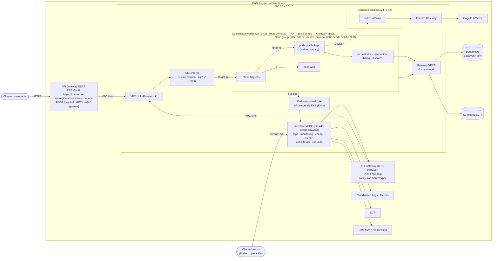

# 04 · Networking: AWS objetivo, equivalentes en Floci y limitaciones

Cubre el punto 13 y el análisis pedido sobre API Gateway privado, VPC Endpoints, VPC Link, ALB/NLB y el endpoint de EKS. Decisiones: [ADR-0010](../adr/0010-red-apigw-vpc-link-nlb-y-vpce.md) y, para la implementación en Terraform y lo verificado en Floci, [ADR-0034](../adr/0034-red-eks-api-gateway-terraform-floci.md).

## Conceptos que no deben confundirse

| Pieza | Dirección del tráfico | Para qué sirve | Para qué **no** sirve |
| --- | --- | --- | --- |
| **API Gateway PRIVATE** (REST) | Cliente **dentro** de una VPC → API Gateway | API invocable solo desde VPCs mediante un Interface VPCE de `execute-api` (o Direct Connect). Solo REST APIs pueden ser privadas. | No conecta API Gateway con backends privados. Un navegador en Internet no puede invocarla. |
| **Interface VPC Endpoint** (PrivateLink, p. ej. `com.amazonaws.<region>.execute-api`, `logs`, `ecr.dkr`) | Recursos **de la VPC** → servicio AWS | Crea ENIs con IP privada en la subred; con *private DNS*, el nombre público del servicio resuelve a esas IPs. El tráfico hacia AWS no sale por Internet. | **No** lleva tráfico desde API Gateway hacia pods. Es una puerta de *salida* de la VPC hacia un servicio, no de *entrada* desde él. |
| **Gateway VPC Endpoint** (S3, DynamoDB) | VPC → S3/DynamoDB | Añade una ruta con *prefix list* a las tablas de rutas indicadas. | No tiene ENI ni DNS propio; no sirve para otros servicios. |
| **VPC Link** | API Gateway → **backend privado** en la VPC | Integración privada. REST API: VPC link a NLB (v1) y, según la documentación vigente, también "VPC link V2" para REST APIs. HTTP API: VPC link V2 a ALB/NLB/Cloud Map. | No hace privada la API: el *front door* sigue siendo el endpoint de API Gateway. |
| **NLB / ALB internos** | VPC Link → pods o nodos | Balanceo L4 (NLB) o L7 (ALB) hacia *targets* `ip` (pods, vía AWS Load Balancer Controller o TargetGroupBinding) o `instance` (NodePort). | No reemplazan a API Gateway en autenticación ni *throttling*. |
| **Endpoint del API server de EKS** (público, privado o ambos) | `kubectl`, CI o nodos → **API de Kubernetes** | Con acceso privado, EKS crea una zona privada de Route 53 y el API server solo es accesible desde la VPC. AWS lo describe como "not a traditional AWS PrivateLink endpoint". | No transporta tráfico de aplicación hacia los pods. |
| **Interface VPCE `com.amazonaws.<region>.eks`** | VPC → **API de gestión de EKS** (`DescribeCluster`, …) | Llamar a la API de EKS sin Internet. | La documentación de EKS lo dice explícitamente: "they do not support access to Kubernetes APIs, as these have a separate private endpoint". |

**Conclusión:** un VPC Endpoint **no conecta** API Gateway con los pods. El camino correcto es API Gateway → **VPC Link** → **NLB interno** → pods. Los VPCE resuelven otra cosa: que el tráfico *desde* la VPC hacia servicios AWS (DynamoDB, S3, CloudWatch, ECR, STS, `execute-api`) no salga a Internet.

## Arquitectura de red objetivo (AWS, por ambiente)

Implementada en `infra/terraform/modules/{network,eks,api-gateway}` ([ADR-0034](../adr/0034-red-eks-api-gateway-terraform-floci.md)).

- **VPC por ambiente** con CIDR que no se solapan, para permitir *peering* futuro: `dev` 10.10.0.0/16, `test` 10.20.0.0/16 y `prod` 10.30.0.0/16. DNS support y DNS hostnames activos.
- **Subredes** en 2 AZ:
  - **Públicas `/24`:** IGW y NAT Gateway, sin cargas de trabajo y sin IP pública automática.
  - **Privadas `/20`:** nodos y pods de EKS, NLB interno, ENIs de los VPCE y del endpoint privado de EKS.
- **Salida:** NAT para destinos sin VPCE (por ejemplo el JWKS de Cognito). Uno compartido en `dev` y `test`; uno por AZ en `prod`.
- **Entrada:**
  - **API Gateway REST Regional (pública):** el cliente consume `https://<id>.execute-api.<región>.amazonaws.com/<env>`. Rutas `POST /graphql` y el SPA (`GET /`, `ANY /{proxy+}`) → **VPC Link** → **NLB interno** → **Traefik** (ingress del clúster, ADR-0032) → Service `graphql-api` o `web` → pods. Un solo origen, sin CORS ([ADR-0017](../adr/0017-frontend-spa-mismo-origen-polling.md)).
  - **API Gateway REST PRIVATE:** `POST /graphql` para consumidores internos (Prefect y operación), accesible solo por el **Interface VPCE `execute-api`**. Su *resource policy* restringe con `aws:SourceVpce`. Cumple el "VPCE hacia API Gateway" de §2.4.
  - El JWT de Cognito lo valida graphql-api (ADR-0026). No hay autorizador de Cognito en API Gateway mientras Cognito siga fuera de Terraform (L-13).
- **VPC Endpoints:** solo los que tienen un consumidor en la VPC (regla de esta fase; detalle en ADR-0034).
  - **Gateway:** `s3` (capas de ECR) y `dynamodb` (tablas del ambiente), en las tablas de rutas privadas, con *endpoint policies* acotadas.
  - **Interface** (private DNS y SG 443 desde las subredes privadas): `logs` (Fluent Bit), `monitoring` (Argo canary), `ecr.api` y `ecr.dkr` (imágenes), `execute-api` (API PRIVATE) y `eks-auth` (Pod Identity).
  - No hay VPCE `sts` (sin IRSA), `eks` (API de gestión, sin consumidor) ni `elasticloadbalancing` (se añadiría con el AWS Load Balancer Controller).
- **EKS:** `endpointPrivateAccess = true` y `endpointPublicAccess = false` en los tres ambientes. El CI y la operación necesitan conectividad privada (runner en la VPC, VPN o bastión).
- **Security groups:**
  - **NLB:** sin reglas de entrada y con la evaluación de PrivateLink desactivada, de modo que solo se entra por el VPC Link. Egreso al puerto del ingress en las subredes privadas.
  - **Clúster/nodos** (SG del clúster de EKS): entrada al puerto del ingress **desde el SG del NLB**.
  - **VPCE:** 443 desde las subredes privadas.
  - DynamoDB y S3 (Gateway) se controlan con *endpoint policies*.

### Recorrido de un paquete (pregunta §6.1)

1. El navegador resuelve el endpoint regional de API Gateway y envía `POST /graphql` (HTTPS).
2. API Gateway aplica el *throttling* del stage (el JWT de Cognito lo valida graphql-api: no hay *Cognito authorizer* mientras Cognito siga fuera de Terraform, L-13), y la integración `HTTP_PROXY` con `connectionType=VPC_LINK` envía la petición por las ENIs del VPC Link en las subredes privadas.
3. El **NLB interno** la reenvía a su *target group* `ip`: las IPs de los pods de **Traefik** (registradas por el AWS Load Balancer Controller). Interviene el SG del NLB (egreso al puerto 8000 de las subredes privadas) y el SG del clúster (entrada desde el SG del NLB).
4. Traefik aplica la `IngressRoute` (`/graphql` → `TraefikService` del canary, ADR-0032) y entrega al Service `graphql-api`, que kube-proxy resuelve a un pod.
5. El pod llama al orquestador por el Service `ClusterIP`, filtrado por las NetworkPolicies.
6. Los servicios escriben en DynamoDB: la tabla de rutas privada tiene la ruta `pl-xxxx (DynamoDB) → vpce-gateway` y el tráfico no sale de la red de AWS.
7. Los logs salen por Fluent Bit hacia `logs.<region>.amazonaws.com`, que gracias al *private DNS* resuelve a las IPs del Interface VPCE `logs` (SG 443).

## Diagrama de networking

Lo que el diagrama **no** dice: ningún VPCE lleva tráfico desde API Gateway hacia el clúster. Ese camino es VPC Link → NLB → target. El VPCE `execute-api` es la salida de la VPC hacia la API **privada**.

## Qué puede demostrar Floci (2.4.0, verificado con Terraform el 2026-11-15)

Evidencia por ambiente: `scripts/floci/network-verify.sh <env>`.

| Elemento | Resultado en Floci | Evidencia |
| --- | --- | --- |
| VPC, subredes, IGW, NAT, tablas de rutas y asociaciones | **Solo metadatos** | Se crean y describen; el NAT es "a record"; no hay enrutamiento |
| Gateway VPCE (S3, DynamoDB) | **Solo metadatos** | `available` y asociados a 2 tablas, pero **0 rutas** de *prefix list* |
| Interface VPCE (6) | **Solo metadatos** | `available`, 2 ENIs y DNS `vpce-…vpce.amazonaws.com` sintetizados; no resuelven |
| Security groups y reglas | **Solo metadatos** | Reglas creadas (NLB sin entrada, SG del clúster ← SG del NLB, VPCE 443); Floci no filtra este tráfico. `describe-security-group-rules` sigue listando la regla de egreso por defecto que Terraform revocó (L-14) |
| EKS: clúster, node group, addon y Pod Identity | **Funcional** (k3s real) y **metadatos** | Clúster `ACTIVE` en la VPC; kubectl con el kubeconfig de Terraform. Un solo nodo; el endpoint privado no se aplica (L-03) |
| API Gateway REST pública por **HTTPS** | **Funcional** | `POST https://<id>.execute-api.localhost.floci.io:4566/dev/graphql` → 200, TLS verificado con la CA de Floci |
| API Gateway PRIVATE + resource policy | **Solo metadatos** | Asociada al VPCE y con la policy guardada, pero responde **200 desde el host** (L-02) |
| VPC Link (V1) | **Funcional en control plane** | `AVAILABLE`; las integraciones `HTTP_PROXY` + `VPC_LINK` se ejecutan |
| NLB (data plane) | **Funcional** | Listener en el contenedor de Floci; health check HTTP; target `healthy` |
| **Camino completo** API Gateway → VPC Link → NLB → k3s:NodePort → Traefik → pod | **Funcional (emulado)** | Respuesta con `x-service-version` del pod; sin token → `UNAUTHENTICATED` |
| Logs de acceso y métricas de API Gateway | **No emulados** | Log group creado; 0 streams; sin métricas `AWS/ApiGateway` (L-14) |
| Pod → Floci | **Funcional por IP**; DNS `floci` **no** resuelve desde los pods | Service sin selector + EndpointSlice (L-07) |

### Configuración local equivalente

| AWS | Floci local |
| --- | --- |
| URI de integración = DNS del NLB (`internal-…elb.amazonaws.com`) | `http://floci:<puerto-listener>` (el DNS `*.elb.floci` no resuelve; el listener vive en el contenedor de Floci) |
| *Target group* con IPs de los pods de Traefik (AWS Load Balancer Controller) | *Target* `ip` = IP del contenedor k3s en la red `aegisvolt-floci` + NodePort `30080` de Traefik. Lo registra `k8s-deploy.sh`. |
| SDK de AWS con endpoints por defecto + *private DNS* de los VPCE | `AWS_ENDPOINT_URL=http://floci:4566` en el overlay local + Service `floci` sin selector |
| Aislamiento por SG, VPCE policies y API PRIVATE | NetworkPolicies de Kubernetes (aplicadas por k3s, verificadas en ADR-0031) + revisión de la configuración de Terraform |
| Endpoint `https://<id>.execute-api.<región>.amazonaws.com/<env>` | `https://<id>.execute-api.localhost.floci.io:4566/<env>` (CA local de Floci) |

### Cómo cumplir §2.4 de forma verificable

1. **Declarativo y verificable en Floci:** toda la red (VPC, subredes, rutas, SG, VPCE con *policies*, API PRIVATE con *resource policy*, VPC Link, NLB) va en módulos de Terraform aplicados por workspace. La evidencia son `terraform plan/apply` y `aws ec2 describe-*`, `aws apigateway get-rest-api`, etc.
2. **Funcional en Floci:** la cadena API Gateway → VPC Link → NLB → k3s → pod se demuestra en vivo.
3. **Aislamiento real:** se demuestra con NetworkPolicies en k3s (prueba negativa: un pod no autorizado no alcanza al orquestador).
4. **Fuera del alcance de Floci:** el enrutamiento por VPCE, el bloqueo real de la API PRIVATE y el endpoint EKS solo-privado. Se documentan con el diagrama y el recorrido del paquete, y se marcan en [`docs/limitations.md`](../limitations.md). Probarlo exigiría una cuenta AWS real, lo que las reglas del proyecto prohíben sin autorización expresa.

## Trazabilidad: requisito / implementación / evidencia / limitación

Resultado de `network-verify.sh dev` (2026-11-15). En `test` y `prod` coincide, salvo EKS y la prueba de punta a punta (L-11).

| Requisito | Implementación | Evidencia (Floci) | Tipo | Limitación |
| --- | --- | --- | --- | --- |
| VPC con CIDR parametrizable | `module.network`, `vpc_cidr` en `envs/<env>.tfvars` | `10.10.0.0/16`, DNS support y hostnames `True` | metadatos | L-01 |
| Subredes públicas y privadas | 2 × `/24` públicas, 2 × `/20` privadas, 2 AZ | `10.10.0.0/24`, `10.10.1.0/24`; `10.10.16.0/20`, `10.10.32.0/20` | metadatos | L-01 |
| Route tables y asociaciones | pública → IGW; privada por AZ → NAT | 4 asociaciones; 0 rutas de *prefix list* | metadatos | Floci no añade rutas de Gateway VPCE |
| Internet Gateway | IGW + ruta pública | `igw-…` asociado | metadatos | L-01 |
| NAT Gateway | 1 en dev/test, 1 por AZ en prod | `available` en la subred pública | metadatos | Floci no traduce direcciones |
| Security groups mínimos | NLB (sin entrada), clúster ← NLB, VPCE 443 | Reglas descritas con `describe-security-groups` | metadatos | Floci no filtra (L-14) |
| VPCE S3, DynamoDB | Gateway + políticas acotadas | `available`, 2 tablas de rutas | metadatos | L-01 |
| VPCE CloudWatch Logs (+ monitoring) | Interface, private DNS | `available`, 2 ENIs, DNS sintetizado | metadatos | L-01 |
| VPCE ECR | `ecr.api`, `ecr.dkr` Interface | `available`, 2 ENIs | metadatos | L-01 |
| Cluster EKS | `module.eks` en subredes privadas | `ACTIVE`, `vpc` del ambiente, privado=True, público=False | funcional | k3s; L-03 |
| Node groups | administrado, subredes privadas | `ACTIVE`, deseado 1 | metadatos | un nodo compartido |
| IAM roles/policies de EKS | roles del clúster y de nodos; 7 roles Pod Identity | 7 asociaciones | metadatos | L-08 |
| Kubeconfig y endpoint | salida `kubeconfig` (exec `aws eks get-token`) | `kubectl get nodes` → `Ready` | funcional | — |
| Endpoint HTTPS para GraphQL | API REST REGIONAL, `POST /graphql` | 200, TLS verificado, `x-service-version` | funcional | Floci acepta también HTTP (L-14) |
| Integración a backend privado | HTTP_PROXY + VPC Link V1 → NLB interno → Traefik | VPC Link `AVAILABLE`; target `healthy` | funcional | URI `http://floci:<puerto>` (L-01) |
| VPCE hacia API Gateway | API PRIVATE + VPCE `execute-api` + policy | Asociada y con policy | metadatos | Responde 200 desde fuera (L-02) |
| "Hacia Kubernetes" privado | endpoint privado del API server de EKS | `endpointPrivateAccess=true` | metadatos | kubectl entra desde el host (L-03) |

## EKS administrado frente al EKS de Floci (k3s)

| Aspecto | AWS EKS | Floci 2.4.0 |
| --- | --- | --- |
| Plano de control | Administrado, multi-AZ, actualizaciones gestionadas | Un contenedor k3s v1.36 por clúster; sin `UpdateClusterConfig` ni `UpdateClusterVersion` (cambiar subredes o versión recrea el clúster) |
| Endpoint del API server | Público y/o privado (ENIs en las subredes); el privado se aplica | `https://localhost:<puerto>`; `endpointPublicAccess=false` se guarda pero no se aplica |
| Autenticación | IAM → access entries o `aws-auth` | Webhook IAM de Floci; requiere una access key emitida por Floci (`test/test` es rechazada) |
| Nodos | EC2 en el node group (ASG), en las subredes elegidas | Un único nodo compartido (el propio k3s); el ASG solo existe como nombre en el node group (`describe-auto-scaling-groups` devuelve 0) |
| Red de pods | VPC CNI: IPs de la VPC; SG del clúster | Flannel de k3s (10.42.0.0/16); los SG no se aplican; NetworkPolicies sí, con kube-router |
| Balanceadores | NLB/ALB reales; AWS Load Balancer Controller | NLB emulado en el contenedor de Floci; target = IP del contenedor k3s + NodePort |
| Identidad de pods | Pod Identity / IRSA con credenciales temporales | Asociaciones guardadas; los pods usan credenciales ficticias por Secret |
| Logs del plano de control | CloudWatch `/aws/eks/<clúster>/cluster` (`api`, `audit`, `authenticator`) | **Emitidos**: el log group existe con streams `kube-apiserver-…` y `kube-apiserver-audit-…`, con eventos reales de auditoría (verificado). No hay stream de `authenticator`. Terraform declara el log group antes del clúster, con retención (7 días en `dev`). |
| Recursos | Escala por nodos | ~1,3 GB por clúster en la máquina local: solo `dev` (L-11) |
| Reinicio | Transparente | El nodo no arranca si el contenedor cambia de IP (L-10) |

