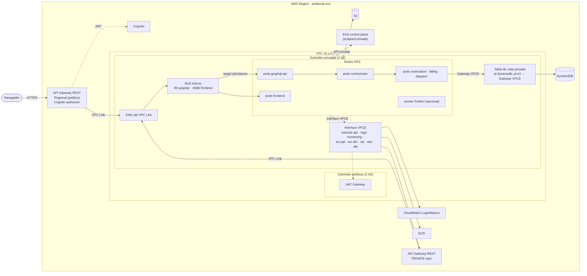

# 04 · Networking: AWS objetivo, equivalentes en Floci y limitaciones

Cubre el punto 13 y el análisis pedido sobre API Gateway privado, VPC Endpoints, VPC Link, ALB/NLB y el endpoint de EKS. Decisión: [ADR-0010](../adr/0010-red-apigw-vpc-link-nlb-y-vpce.md).

## Conceptos que no deben confundirse

| Pieza | Dirección del tráfico | Para qué sirve | Para qué **no** sirve |
| --- | --- | --- | --- |
| **API Gateway PRIVATE** (REST) | Cliente **dentro** de una VPC → API Gateway | API invocable solo desde VPCs mediante un Interface VPCE de `execute-api` (o Direct Connect). Solo REST APIs pueden ser privadas. | No conecta API Gateway con backends privados. Un navegador en Internet no puede invocarla. |
| **Interface VPC Endpoint** (PrivateLink, p. ej. `com.amazonaws.<region>.execute-api`, `logs`, `ecr.dkr`) | Recursos **de la VPC** → servicio AWS | Crea ENIs con IP privada en la subred; con *private DNS*, el nombre público del servicio resuelve a esas IPs. El tráfico hacia AWS no sale por Internet. | **No** lleva tráfico desde API Gateway hacia pods. Es una puerta de *salida* de la VPC hacia un servicio, no de *entrada* desde él. |
| **Gateway VPC Endpoint** (S3, DynamoDB) | VPC → S3/DynamoDB | Añade una ruta con *prefix list* a las tablas de rutas indicadas. | No tiene ENI ni DNS propio; no sirve para otros servicios. |
| **VPC Link** | API Gateway → **backend privado** en la VPC | Integración privada. REST API: VPC link a NLB (v1) y, según la documentación vigente, también "VPC link V2" para REST APIs. HTTP API: VPC link V2 a ALB/NLB/Cloud Map. | No hace privada la API: el *front door* sigue siendo el endpoint de API Gateway. |
| **NLB / ALB internos** | VPC Link → pods o nodos | Balanceo L4 (NLB) o L7 (ALB) hacia *targets* `ip` (pods, vía AWS Load Balancer Controller o TargetGroupBinding) o `instance` (NodePort). | No reemplazan a API Gateway en autenticación ni *throttling*. |
| **Endpoint del API server de EKS** (público, privado o ambos) | `kubectl`, CI o nodos → **API de Kubernetes** | Con acceso privado, EKS crea una zona privada de Route 53 y el API server solo es accesible desde la VPC. AWS lo describe como "not a traditional AWS PrivateLink endpoint". | No transporta tráfico de aplicación hacia los pods. |
| **Interface VPCE `com.amazonaws.<region>.eks`** | VPC → **API de gestión de EKS** (`DescribeCluster`, …) | Llamar a la API de EKS sin Internet. | La documentación de EKS lo dice explícitamente: "they do not support access to Kubernetes APIs, as these have a separate private endpoint". |

**Conclusión:** un VPC Endpoint **no conecta** API Gateway con los pods. El camino correcto es API Gateway → **VPC Link** → **NLB interno** → pods. Los VPCE resuelven otra cosa: que el tráfico *desde* la VPC hacia servicios AWS (DynamoDB, S3, CloudWatch, ECR, STS, `execute-api`) no salga a Internet.

## Arquitectura de red objetivo (AWS, por ambiente)

- **VPC por ambiente** con CIDR que no se solapan, para permitir *peering* futuro: `dev` 10.10.0.0/16, `test` 10.20.0.0/16 y `prod` 10.30.0.0/16.
- **Subredes** en 2 AZ:
  - **Públicas:** NAT Gateway para la salida controlada que no cubren los VPCE (en `dev` y `test` uno solo; en `prod` uno por AZ). No contienen cargas de trabajo.
  - **Privadas de aplicación:** nodos y pods de EKS, NLB interno, ENIs de los VPCE y del VPC Link.
- **Entrada:**
  - **API Gateway REST Regional (pública)** con *Cognito authorizer* y *throttling*: `/graphql` → VPC Link → NLB interno, listener 80 → `graphql-api`; `/{proxy+}` → VPC Link → NLB, listener 8080 → `frontend`. Un solo origen, sin CORS ([ADR-0017](../adr/0017-frontend-spa-mismo-origen-polling.md)).
  - **API Gateway REST PRIVATE** (`/ops`) para consumidores internos (worker de Prefect y herramientas de operación), accesible solo por el **Interface VPCE `execute-api`**. Su *resource policy* restringe con `aws:SourceVpce`. Cumple el "VPCE hacia API Gateway" de §2.4.
- **VPC Endpoints:**
  - **Gateway:** S3 y DynamoDB, asociados a las tablas de rutas privadas.
  - **Interface** (con *private DNS* y un security group que admite 443 solo desde las subredes privadas): `logs` y `monitoring` (CloudWatch), `ecr.api`, `ecr.dkr`, `sts` (IRSA), `eks-auth` (si se usa Pod Identity), `elasticloadbalancing` (Load Balancer Controller), `eks` (API de gestión desde la VPC) y `execute-api`.
  - Esta lista sigue la tabla de VPCE para clústeres privados de la documentación de EKS.
- **EKS:** `endpointPrivateAccess = true`. En `test` y `prod`, `endpointPublicAccess = false`, de modo que el CI debe ejecutarse dentro de la VPC o en un runner con conectividad privada. En `dev` es público, restringido por CIDR.
- **Security groups:**
  - VPC Link → NLB: el puerto del listener.
  - NLB → nodos: el rango NodePort o los puertos de los pods.
  - VPCE: 443 desde las subredes privadas.
  - DynamoDB y S3 (Gateway) se controlan con *endpoint policies* que restringen a las tablas y buckets `aegisvolt-*-<env>`.

### Recorrido de un paquete (pregunta §6.1)

1. El navegador resuelve el endpoint regional de API Gateway y envía `POST /graphql` (HTTPS).
2. API Gateway aplica el *Cognito authorizer* y el *throttling*, y la integración `HTTP_PROXY` con `connectionType=VPC_LINK` envía la petición por las ENIs del VPC Link en las subredes privadas.
3. El **NLB interno** (listener 80) la reenvía a su *target group*: IPs de los pods de `graphql-api` (modo `ip`) o NodePort de los nodos (modo `instance`). Intervienen el security group del NLB y el de los nodos o pods.
4. kube-proxy o la VPC CNI entregan el paquete al pod `graphql-api`.
5. El pod llama al orquestador por el Service `ClusterIP`, filtrado por las NetworkPolicies.
6. Los servicios escriben en DynamoDB: la tabla de rutas privada tiene la ruta `pl-xxxx (DynamoDB) → vpce-gateway` y el tráfico no sale de la red de AWS.
7. Los logs salen por Fluent Bit hacia `logs.<region>.amazonaws.com`, que gracias al *private DNS* resuelve a las IPs del Interface VPCE `logs` (SG 443).

## Diagrama de networking

## Qué puede demostrar Floci (2.4.0, verificado el 2026-11-12)

| Elemento | Resultado en Floci | Evidencia |
| --- | --- | --- |
| VPC, subredes, tablas de rutas, SG | **Solo metadatos** | `create/describe` funcionan; sin enrutamiento real |
| Gateway VPCE (DynamoDB) | **Solo metadatos** | Estado `available`, pero **no añade** rutas de *prefix list* |
| Interface VPCE (`execute-api`) | **Solo metadatos** | Estado `available`, con ENI y DNS `*.vpce.amazonaws.com` sintetizados |
| API Gateway REST + MOCK | **Funcional** | Invocación `/execute-api/{id}/{stage}/…` → 200 |
| API Gateway PRIVATE | **Parcial** | Se crea con `vpcEndpointIds`, pero responde 200 desde el host: **sin aislamiento** |
| VPC Link (REST) | **Funcional en control plane** | `create-vpc-link` con el ARN del NLB → `AVAILABLE`; la integración `HTTP_PROXY` + `VPC_LINK` se ejecuta |
| NLB (ELBv2) data plane | **Funcional** | Floci levanta el listener dentro de su contenedor (`floci:<puerto>`) y reenvía a un *target* `ip` |
| **Cadena completa** API Gateway → VPC Link → NLB → NodePort k3s → pod | **Funcional** | `curl …/execute-api/<id>/p/` → 200 servido por un pod nginx en k3s (registrado en el log del pod) |
| Acceso de EKS: `endpointPublicAccess=false` | **Solo metadatos** | `describe-cluster` lo refleja, pero `kubectl` sigue accediendo desde el host |
| Pod → Floci | **Funcional por IP**; DNS `floci` **no** resuelve desde los pods | Resuelto con un Service sin selector + EndpointSlice hacia la IP fija de Floci (verificado) |

### Configuración local equivalente

| AWS | Floci local |
| --- | --- |
| URI de integración = DNS del NLB (`internal-…elb.amazonaws.com`) | `http://floci:<puerto-listener>` (el DNS `*.elb.floci` no resuelve; el listener vive en el contenedor de Floci) |
| *Target group* con IPs de pods (LB Controller) | *Target* `ip` = IP del contenedor k3s en la red `aegisvolt-floci` + NodePort. Lo registra un script local; el *data plane* fue verificado. |
| SDK de AWS con endpoints por defecto + *private DNS* de los VPCE | `AWS_ENDPOINT_URL=http://floci:4566` en el overlay local + Service `floci` sin selector |
| Aislamiento por SG, VPCE policies y API PRIVATE | NetworkPolicies de Kubernetes (aplicadas de verdad por k3s, a verificar) + revisión estática de Terraform |

### Cómo cumplir §2.4 de forma verificable

1. **Declarativo y verificable en Floci:** toda la red (VPC, subredes, rutas, SG, VPCE con *policies*, API PRIVATE con *resource policy*, VPC Link, NLB) va en módulos de Terraform aplicados por workspace. La evidencia son `terraform plan/apply` y `aws ec2 describe-*`, `aws apigateway get-rest-api`, etc.
2. **Funcional en Floci:** la cadena API Gateway → VPC Link → NLB → k3s → pod se demuestra en vivo.
3. **Aislamiento real:** se demuestra con NetworkPolicies en k3s (prueba negativa: un pod no autorizado no alcanza al orquestador).
4. **Fuera del alcance de Floci:** el enrutamiento por VPCE, el bloqueo real de la API PRIVATE y el endpoint EKS solo-privado. Se documentan con el diagrama y el recorrido del paquete, y se marcan en [`docs/limitations.md`](../limitations.md). Probarlo exigiría una cuenta AWS real, lo que las reglas del proyecto prohíben sin autorización expresa.
