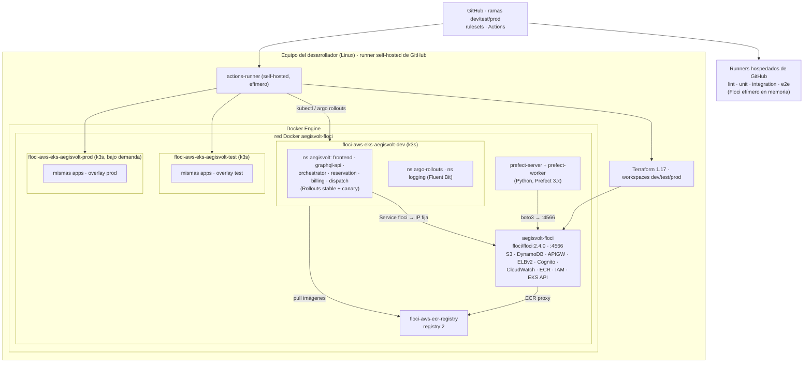

# 05 · Terraform, EKS/Kubernetes, despliegues y canary

Cubre los puntos 14 y 15. Decisiones: [ADR-0011](../adr/0011-terraform-workspaces-backend-s3-bootstrap.md), [ADR-0012](../adr/0012-eks-cluster-por-ambiente-kustomize-acceso-floci.md) y [ADR-0032](../adr/0032-canary-argo-rollouts-traefik-cloudwatch.md) (reemplaza a ADR-0013).

## 14. Terraform: workspaces y backend S3 remoto

### Estructura

```text
infra/terraform/      (implementado: ADR-0033)
  bootstrap/        # bucket de estado (versioning, SSE, public access block, ownership, política, lifecycle). Estado local inicial → migrado al bucket
  global/           # compartido entre ambientes: repositorios ECR y ajuste de cuenta de API Gateway. Clave de estado propia, sin workspaces
  live/             # raíz única de los ambientes. Workspaces dev | test | prod
    main.tf  variables.tf  outputs.tf  providers.tf  moved.tf  feature-flags.json
    config/floci/{backend.hcl,target.tfvars}   # destino local (separado de cualquier destino real)
    envs/dev.tfvars  envs/test.tfvars  envs/prod.tfvars
  modules/
    network/        # VPC, subredes, rutas, NAT, VPCE Gateway e Interface con sus políticas
    dynamodb-table/ # tabla genérica (PK/SK, GSIs, PITR, deletion protection, TTL); live/ instancia las 5 del ambiente y la semilla de flags
    eks/            # clúster, node group, roles, addon y Pod Identity
    api-gateway/    # NLB interno, VPC Link, API REST pública y PRIVATE, stages
    cloudwatch/     # log groups /aegisvolt/<env>/<svc>, retención, metric filters, alarmas
    iam/            # roles por servicio con mínimo privilegio (Pod Identity)
    ecr/            # repositorios inmutables (instanciado en global/)
```

> Cognito (`identity`) sigue fuera de Terraform: [L-13](../limitations.md#l-13--cognito-todavía-se-crea-con-aws-cli).

### Backend

```hcl
# live/backend.tf (configuración parcial; los valores van en backend.<target>.hcl)
terraform { backend "s3" {} }
```

- **Clave:** `aegisvolt/terraform.tfstate`. El prefijo por defecto `workspace_key_prefix = "env:"` produce `env:/dev/aegisvolt/terraform.tfstate`, `env:/test/...` y `env:/prod/...`.
- **Bucket:** `aegisvolt-tfstate` (en AWS real, con sufijo de cuenta), con *versioning* `Enabled`, cifrado SSE, *public access block* y *lifecycle* que conserva las versiones antiguas 90 días y siempre las 10 últimas.
- **Bloqueo:** `use_lockfile = true`, nativo de S3; `dynamodb_table` está deprecado según la documentación de Terraform.
- **Configuración separada:** el backend se configura **aparte** del provider (verificado en la fase de Floci). En local usa `endpoints.s3 = http://localhost:4566` y `use_path_style`.
- **Bootstrap:** el bucket no puede vivir en el estado que guarda. `bootstrap/` se aplica primero con backend local y luego se migra a sí mismo al bucket con `terraform init -migrate-state`.

### Guardas que evitan que `apply` en `test` toque `prod` (pregunta §6.1)

1. **Estado separado:** cada workspace lee y escribe solo `env:/<ws>/...`. Desde `test`, los recursos de `prod` no aparecen en el estado, así que Terraform no puede modificarlos ni destruirlos.
2. **Nombres derivados del workspace:** `local.env = terraform.workspace`. Todos los recursos llevan `-${local.env}` y no hay colisiones.
3. **Precondición:** un `check`/`precondition` exige que `terraform.workspace` esté en `["dev","test","prod"]` y que `var.environment == terraform.workspace`. Esto evita usar `default` o un `tfvars` equivocado.
4. **El CI elige el workspace a partir de la rama destino,** nunca de una entrada manual ([07-cicd.md](07-cicd.md)).
5. **`prod`:** `deletion_protection_enabled` en DynamoDB y `lifecycle { prevent_destroy = true }` en tablas y bucket.
6. **Recuperación:** versionado del bucket y runbook de restauración (abajo).

La propia documentación de Terraform advierte que los workspaces "are not a suitable isolation mechanism" cuando se requieren credenciales separadas. La especificación los exige, así que se mitiga con las guardas anteriores ([ADR-0011](../adr/0011-terraform-workspaces-backend-s3-bootstrap.md)).

### Restaurar un `tfstate` corrupto (pregunta §6.1)

```bash
aws s3api list-object-versions --bucket <bucket> --prefix 'env:/dev/aegisvolt/terraform.tfstate'
aws s3api get-object --bucket <bucket> --key 'env:/dev/aegisvolt/terraform.tfstate' --version-id <id-previo> restored.tfstate
terraform workspace select dev && terraform state push restored.tfstate     # o copiar la versión como la más reciente
terraform plan   # debe mostrar exactamente la diferencia esperada
```

Runbook: [terraform.md](../runbooks/terraform.md).

## 15. EKS/Kubernetes, despliegues y canary

### Topología

- **Un clúster EKS por ambiente:** `aegisvolt-<env>`, declarado en Terraform. En Floci es un contenedor k3s por clúster, no un EKS administrado (L-03).
- **Namespaces:** `aegisvolt` (aplicación), `argo-rollouts` (controlador) y `logging` (Fluent Bit).
- **Manifiestos** con **Kustomize** (integrado en `kubectl`, sin dependencias nuevas):

```text
infra/k8s/
  base/                 # Rollout/Deployment, Service, ServiceAccount, NetworkPolicy, PDB, ConfigMap por app
  components/floci/     # Service+EndpointSlice "floci", AWS_ENDPOINT_URL, Secret con credenciales ficticias
  overlays/dev|test|prod/  # réplicas, recursos, nombres de tabla y log group, digests de imagen
```

- **Workloads:**
  - `frontend` y `graphql-api`: Service `NodePort` en local, *targets* `ip` del NLB en AWS.
  - `saga-orchestrator-service` y los tres servicios de dominio: `ClusterIP`.
  - Todos con `readinessProbe` (`/health/ready`: DynamoDB y flags accesibles), `livenessProbe` (`/health/live`), `resources`, `securityContext` no root y `PodDisruptionBudget`.
- **Acceso de los pods a Floci:**
  - El compose de Floci tendrá una **IP fija** en la red `aegisvolt-floci` (cambio pendiente, a implementar en la fase de K8s).
  - El componente Kustomize `floci` crea un Service `floci` sin selector con un EndpointSlice hacia esa IP. Así `floci:4566` funciona por HTTP y por HTTPS (con el SAN `floci`), y coincide con el `iss` de los tokens de Cognito (`https://floci:4566/...`).
  - Verificado: un pod alcanza `floci:4566` con este mecanismo.

### Imágenes y promoción

- Una imagen por app (Dockerfile multi-stage, usuario no root) **construida una sola vez** al hacer merge a `dev`, con la etiqueta `sha-<commit>`, y publicada en ECR. En Floci, ECR verificado: `localhost:4566/<cuenta>/<región>/<repo>`.
- La promoción a `test` y `prod` **reutiliza el mismo digest**, sin recompilar. Los overlays referencian `image@sha256:<digest>`.

### Canary

> Este apartado se rediseñó tras verificar contra el clúster ([ADR-0032](../adr/0032-canary-argo-rollouts-traefik-cloudwatch.md), que reemplaza a [ADR-0013](../adr/0013-canary-argo-rollouts-analisis-cloudwatch.md)). El diseño anterior repartía por réplicas y analizaba con un Job, porque se suponía que el proveedor CloudWatch no estaba en el núcleo de Argo. No era así.

- **Qué se canariza:** graphql-api, que recibe el tráfico externo. Los servicios internos (este-oeste por `ClusterIP`) usan `RollingUpdate`; repartirlos por peso exigiría una malla de servicios.
- **Herramientas:** Argo Rollouts v1.10.1 con `trafficRouting.traefik`. Traefik v3.7.16 reparte por peso con un `TraefikService` (WRR). El porcentaje no depende del número de pods.
- **Pasos:** `setWeight: 20` (80/20) → `analysis` → `setWeight: 50` → `analysis` → 100 %. Si falla, se aborta y se vuelve a 100/0 automáticamente.
- **Versiones identificables:** etiqueta `version=<sha>` en la plantilla, cabecera `x-service-version` en cada respuesta y campo `version` en cada log.
- **Análisis** (pregunta §6.2), con el proveedor CloudWatch nativo de Argo (contra Floci en local):
  1. **Disponibilidad:** `/health/ready` del canary cada 10 s, al menos 11 de 12 sondeos.
  2. **Tasa de error del servidor:** métricas `GraphqlOperations` y `GraphqlServerErrors` por `Version`, que generan los metric filters sobre el log `graphql_operation`. Umbral ≤ 2 % con **al menos 30 operaciones** en 3 min; con menos, la medición es Inconclusive y el Rollout se pausa.
  3. **Resultados de negocio:** errores de cliente y SAGAs `COMPENSATED` no cuentan como error. Así, la demo de fallos no provoca un rollback.
- **Evidencia** (promoción, rollback inducido y pausa por muestra insuficiente, con el tráfico medido por respuesta): [runbook](../runbooks/canary-rollback.md).

## Diagrama de despliegue


