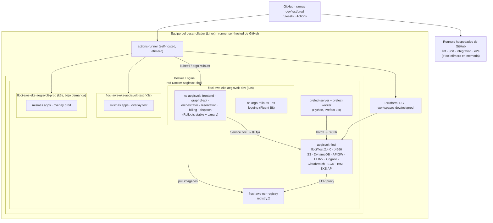

# 05 · Terraform, EKS/Kubernetes, despliegues y canary

Cubre los puntos 14 y 15. Decisiones: [ADR-0011](../adr/0011-terraform-workspaces-backend-s3-bootstrap.md), [ADR-0012](../adr/0012-eks-cluster-por-ambiente-kustomize-acceso-floci.md) y [ADR-0013](../adr/0013-canary-argo-rollouts-analisis-cloudwatch.md).

## 14. Terraform: workspaces y backend S3 remoto

### Estructura

```text
infra/terraform/
  bootstrap/        # bucket de estado (versioning, cifrado, public access block). Estado inicial local → migrado al bucket
  global/           # recursos compartidos entre ambientes: repositorios ECR. Clave de estado propia, sin workspaces
  live/             # raíz única de los ambientes. Workspaces dev | test | prod
    main.tf  variables.tf  outputs.tf  backend.tf (parcial)
    envs/dev.tfvars  envs/test.tfvars  envs/prod.tfvars
  modules/
    network/        # VPC, subredes, rutas, NAT, SG
    vpc-endpoints/  # Gateway (S3, DynamoDB) + Interface (logs, monitoring, ecr.*, sts, eks, elb, execute-api) + policies
    dynamodb-table/ # tabla genérica (PK/SK, GSIs, PITR, deletion protection, TTL)
    data/           # instancia las 5 tablas del ambiente + semilla de flags
    eks/            # clúster, node group, acceso (privado/público)
    edge/           # NLB interno, target groups, VPC Link, API REST pública y PRIVATE, stages
    identity/       # Cognito User Pool, grupos, cliente
    observability/  # log groups /aegisvolt/<env>/<svc>, retención, metric filters, alarmas
    iam/            # roles por servicio con mínimo privilegio
```

### Backend

```hcl
# live/backend.tf (configuración parcial; los valores van en backend.<target>.hcl)
terraform { backend "s3" {} }
```

- **Clave:** `aegisvolt/terraform.tfstate`. El prefijo por defecto `workspace_key_prefix = "env:"` produce `env:/dev/aegisvolt/terraform.tfstate`, `env:/test/...` y `env:/prod/...`.
- **Bucket:** `aegisvolt-tfstate-<cuenta>`, con *versioning* `Enabled`, cifrado SSE, *public access block* y *lifecycle* que conserva versiones antiguas N días.
- **Bloqueo:** `use_lockfile = true`, nativo de S3; `dynamodb_table` está deprecado según la documentación de Terraform.
- **Configuración separada:** el backend se configura **aparte** del provider (verificado en la fase de Floci). En local usa `endpoints.s3 = http://localhost:4566` y `use_path_style`.
- **Bootstrap:** el bucket no puede vivir en el estado que guarda. `bootstrap/` se aplica primero con backend local y luego se migra a sí mismo al bucket con `terraform init -migrate-state`.

### Guardas que evitan que `apply` en `test` toque `prod` (pregunta §6.1)

1. **Estado separado:** cada workspace lee y escribe solo `env:/<ws>/...`. Desde `test`, los recursos de `prod` no aparecen en el estado, así que Terraform no puede modificarlos ni destruirlos.
2. **Nombres derivados del workspace:** `local.env = terraform.workspace`. Todos los recursos llevan `-${local.env}` y no hay colisiones.
3. **Precondición:** un `check`/`precondition` exige que `terraform.workspace` esté en `["dev","test","prod"]` y que `var.environment == terraform.workspace`. Esto evita usar `default` o un `tfvars` equivocado.
4. **El CI elige el workspace a partir de la rama destino,** nunca de una entrada manual ([07-cicd.md](07-cicd.md)).
5. **`prod`:** `deletion_protection_enabled` en DynamoDB y `lifecycle { prevent_destroy = true }` en tablas y bucket.
6. **Recuperación:** versionado del bucket y runbook de restauración (abajo).

La propia documentación de Terraform advierte que los workspaces "are not a suitable isolation mechanism" cuando se requieren credenciales separadas. La especificación los exige, así que se mitiga con las guardas anteriores ([ADR-0011](../adr/0011-terraform-workspaces-backend-s3-bootstrap.md)).

### Restaurar un `tfstate` corrupto (pregunta §6.1)

```bash
aws s3api list-object-versions --bucket <bucket> --prefix 'env:/dev/aegisvolt/terraform.tfstate'
aws s3api get-object --bucket <bucket> --key 'env:/dev/aegisvolt/terraform.tfstate' --version-id <id-previo> restored.tfstate
terraform workspace select dev && terraform state push restored.tfstate     # o copiar la versión como la más reciente
terraform plan   # debe mostrar exactamente la diferencia esperada
```

Se documentará como runbook en `docs/runbooks/` durante la fase de IaC.

## 15. EKS/Kubernetes, despliegues y canary

### Topología

- **Un clúster EKS por ambiente:** `aegisvolt-<env>`, declarado en Terraform. En Floci es un contenedor k3s por clúster, no un EKS administrado (L-03).
- **Namespaces:** `aegisvolt` (aplicación), `argo-rollouts` (controlador) y `logging` (Fluent Bit).
- **Manifiestos** con **Kustomize** (integrado en `kubectl`, sin dependencias nuevas):

```text
infra/k8s/
  base/                 # Rollout/Deployment, Service, ServiceAccount, NetworkPolicy, PDB, ConfigMap por app
  components/floci/     # Service+EndpointSlice "floci", AWS_ENDPOINT_URL, Secret con credenciales ficticias
  overlays/dev|test|prod/  # réplicas, recursos, nombres de tabla y log group, digests de imagen
```

- **Workloads:**
  - `frontend` y `graphql-api`: Service `NodePort` en local, *targets* `ip` del NLB en AWS.
  - `saga-orchestrator-service` y los tres servicios de dominio: `ClusterIP`.
  - Todos con `readinessProbe` (`/health/ready`: DynamoDB y flags accesibles), `livenessProbe` (`/health/live`), `resources`, `securityContext` no root y `PodDisruptionBudget`.
- **Acceso de los pods a Floci:**
  - El compose de Floci tendrá una **IP fija** en la red `aegisvolt-floci` (cambio pendiente, a implementar en la fase de K8s).
  - El componente Kustomize `floci` crea un Service `floci` sin selector con un EndpointSlice hacia esa IP. Así `http://floci:4566` funciona y coincide con el `iss` de los tokens de Cognito.
  - Verificado: un pod alcanza `floci:4566` con este mecanismo.

### Imágenes y promoción

- Una imagen por app (Dockerfile multi-stage, usuario no root) **construida una sola vez** al hacer merge a `dev`, con la etiqueta `sha-<commit>`, y publicada en ECR. En Floci, ECR verificado: `localhost:4566/<cuenta>/<región>/<repo>`.
- La promoción a `test` y `prod` **reutiliza el mismo digest**, sin recompilar. Los overlays referencian `image@sha256:<digest>`.

### Canary

**Herramienta:** Argo Rollouts v1.10.2 (última estable verificada), con estrategia **canary basada en réplicas**, sin *traffic router*. Según su documentación, el reparto se logra "via a weighted replica counts". Como el Service `ClusterIP` selecciona pods stable y canary por igual, el porcentaje de tráfico es aproximadamente el porcentaje de pods.

```yaml
strategy:
  canary:
    canaryMetadata: { labels: { track: canary } }
    stableMetadata: { labels: { track: stable } }
    steps:
      - setWeight: 20          # 1 de 5 réplicas
      - pause: { duration: 60s }
      - analysis: { templates: [{ templateName: canary-health }] }
      - setWeight: 100
```

| Ambiente | Réplicas por app | Peso canary efectivo |
| --- | --- | --- |
| `dev` | 2 | 50 % (1 de 2): no se puede representar el 20 %; se documenta |
| `test` | 5 en `graphql-api` y orquestador; 2 en el resto | 20 % / 50 % |
| `prod` | 5 | 20 % |

**Análisis** (pregunta §6.2). El `AnalysisTemplate canary-health` usa el proveedor **Kubernetes Job**, porque el proveedor CloudWatch no está en el núcleo de Argo Rollouts y no se pudo verificar un endpoint configurable. El Job ejecuta un *checker* (imagen propia con AWS CLI) contra CloudWatch (Floci en local):

1. **Tasa de error de la versión canary:**
   - Cuenta en `/aegisvolt/<env>/<app>` los logs con `version = <sha canary>` y `http_status >= 500` o `level = "error"`, frente al total de requests de esa versión en la ventana.
   - Se cuenta en el cliente con `FilterLogEvents`, porque Floci no soporta *metric math* ni `stats` en Logs Insights (verificado y documentado).
2. **Umbral de éxito:** tasa ≤ 1 % **y** al menos 30 requests en la ventana. El *pipeline* genera tráfico sintético con una flota `canary-probe`.
3. **Salud:** todas las réplicas canary `Ready` y `/health/ready` = 200.
4. **Resultados de negocio:** las SAGAs `COMPENSATED` (fondos insuficientes o falla simulada) son **resultados válidos** con HTTP 200 y no cuentan como error. Así, la demo de fallos no provoca un rollback.

Si el análisis falla, Argo Rollouts aborta y **vuelve automáticamente** a la versión stable (escala el ReplicaSet canary a 0). El job de CD espera con `kubectl argo rollouts status --timeout` y falla visiblemente.

Pendiente de verificar en las fases de K8s y CI/CD: `canaryMetadata`/`stableMetadata`, el soporte de patrones JSON en `FilterLogEvents` de Floci, el consumo de memoria de tres clústeres k3s simultáneos (riesgo R-02) y el plugin `kubectl argo rollouts`.

## Diagrama de despliegue


