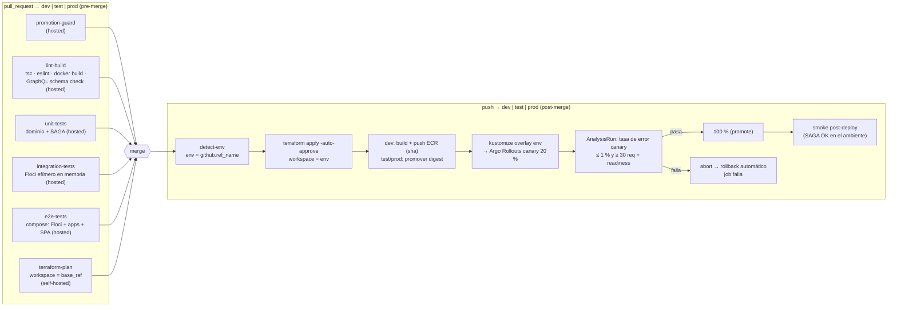

# 07 · CI/CD, ramas y promoción

Cubre el punto 17. Decisión: [ADR-0015](../adr/0015-cicd-github-actions-hibrido-y-promocion.md).

## Ramas

- **Ramas de ambiente:** `dev`, `test` y `prod`, todas protegidas. `dev` será la rama por defecto. El destino de la rama actual `main` está pendiente de confirmar (P-22).
- **Ramas de trabajo:** `feature/<tema>` y `fix/<tema>`, creadas **desde `dev`**.
- **Promoción lineal:** `feature/*` → `dev` (PR) → `test` (PR con origen `dev`) → `prod` (PR con origen `test`). No hay *hotfix* directo a `test` o `prod`: también siguen la cadena.

### Reglas (GitHub Rulesets / branch protection) sobre `dev`, `test` y `prod`

| Regla | Configuración | Requisito |
| --- | --- | --- |
| Block force pushes | Activa | §3.1.1 |
| Restrict deletions | Activa | Protección adicional |
| Require a pull request before merging | Activa, con 0 aprobaciones requeridas (proyecto individual: el autor no puede aprobar su propio PR) | §3.1.2 |
| Require status checks to pass | `lint-build`, `unit-tests`, `integration-tests`, `e2e-tests`, `terraform-plan` y `promotion-guard` | §3.1.3 |
| Sin bypass | Lista de bypass vacía en el ruleset, o "Do not allow bypassing the above settings" en branch protection | Para que también bloquee al administrador |

- **`promotion-guard`:** ninguna regla nativa revisada restringe la rama origen de un PR, así que un check obligatorio falla si:
  - el destino es `test` y el origen no es `dev`;
  - el destino es `prod` y el origen no es `test`;
  - el destino es `dev` y el origen no cumple `feature/*` o `fix/*`.
- **Método de merge:**
  - `feature → dev`: *squash*, para un historial limpio.
  - `dev → test` y `test → prod`: **merge commit**, nunca *squash* ni *rebase*. Con *squash* las ramas divergen y cada promoción posterior genera conflictos, justo lo que §3.2 quiere evitar.
- **Disponibilidad en GitHub Free** (verificada en la documentación): la protección de ramas y los *environments* solo están disponibles para **repositorios públicos**. Para un repo privado hace falta GitHub Pro. Decisión pendiente del autor (P-21).

## Pipelines (GitHub Actions)



### Detección dinámica del ambiente (pregunta §6.2)

```yaml
# Sketch; la versión definitiva se escribe y verifica en la fase de CI/CD.
on:
  pull_request: { branches: [dev, test, prod] }
  push:         { branches: [dev, test, prod] }
jobs:
  terraform:
    runs-on: [self-hosted, aegisvolt-floci]
    env:
      # pull_request → rama destino (github.base_ref); push → rama que recibió el merge (github.ref_name)
      TARGET_ENV: ${{ github.event_name == 'pull_request' && github.base_ref || github.ref_name }}
    steps:
      - run: |
          case "$TARGET_ENV" in dev|test|prod) ;; *) echo "ambiente inválido: $TARGET_ENV"; exit 1;; esac
          terraform -chdir=infra/terraform/live workspace select "$TARGET_ENV"
          terraform -chdir=infra/terraform/live plan -var-file="envs/$TARGET_ENV.tfvars" -out=tfplan
      - if: github.event_name == 'push'
        run: terraform -chdir=infra/terraform/live apply -auto-approve tfplan
```

- **`concurrency: terraform-${{ env }}`** evita dos `apply` simultáneos sobre el mismo ambiente; el *lockfile* de S3 es la segunda barrera.
- **El `apply` post-merge vuelve a planificar** sobre el estado actual en lugar de reutilizar el plan del PR, que pudo quedar obsoleto si otro PR se fusionó antes.

### Runners: híbridos

| Job | Runner | Motivo |
| --- | --- | --- |
| `promotion-guard`, `lint-build`, `unit-tests`, `integration-tests`, `e2e-tests` | Hospedado por GitHub | No necesitan estado persistente: levantan Floci efímero (`FLOCI_STORAGE_MODE=memory`) como contenedor de servicio |
| `terraform-plan`, `terraform apply`, despliegue, canary, smoke | **Self-hosted** en el equipo que ejecuta Floci de forma persistente (label `aegisvolt-floci`) | Los ambientes `dev`/`test`/`prod` viven en ese Floci: un runner en la nube no puede alcanzarlos y un Floci efímero no tendría el estado de los ambientes |

**Riesgo:** la documentación de GitHub dice que los self-hosted runners "should almost never be used for public repositories". Mitigaciones si el repo es público:
- los jobs self-hosted solo corren en `push` a ramas protegidas y en PRs cuyo `head.repo == repo` (nunca desde *forks*);
- se exige aprobación para workflows de colaboradores externos;
- el runner es efímero (`--ephemeral`) y no tiene credenciales reales de AWS.

Ver [ADR-0015](../adr/0015-cicd-github-actions-hibrido-y-promocion.md) y P-21.

## Demostraciones de §6.2

- **`git push --force origin test` o push directo:** GitHub lo rechaza (`GH013: Repository rule violations`), con la regla visible en *Settings → Rules*.
- **YAML:** la línea `TARGET_ENV` y el `case` muestran cómo se decide el workspace.
- **Canary:** el umbral está en `AnalysisTemplate canary-health` (tasa de error ≤ 1 %, ≥ 30 requests y readiness).
