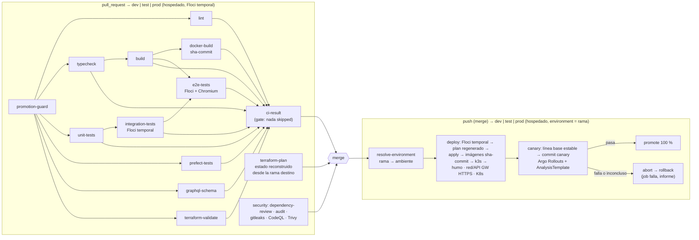

# 07 · CI/CD, ramas y promoción

Cubre el punto 17. Decisiones: [ADR-0015](../adr/0015-cicd-github-actions-hibrido-y-promocion.md) (ramas, promoción y métodos de merge) y [ADR-0035](../adr/0035-cicd-github-actions-runners-hospedados-floci-efimero.md) (implementación: solo runners hospedados, Floci efímero). Configuración manual: [github-repository-settings.md](../runbooks/github-repository-settings.md).

## Ramas

- **Ramas de ambiente:** `dev`, `test` y `prod`, todas protegidas. `dev` es la rama por defecto.
- **Ramas de trabajo:** `feature/*`, `fix/*`, `chore/*` y `docs/*`, creadas desde `dev`. Además `dependabot/*`, que crea Dependabot en este repositorio.
- **Promoción lineal:** `feature/*` → `dev` (PR) → `test` (PR con origen `dev`) → `prod` (PR con origen `test`). No hay *hotfix* directo a `test` o `prod`.

### Reglas sobre `dev`, `test` y `prod`

| Regla | Configuración | Requisito |
| --- | --- | --- |
| Block force pushes | Activa | §3.1.1 |
| Restrict deletions | Activa | Protección adicional |
| Require a pull request before merging | Activa (bloquea el push directo), 0 aprobaciones en proyecto individual | §3.1.2 |
| Merge method | `dev`: squash; `test` y `prod`: merge commit | Evita la divergencia entre ramas |
| Require status checks to pass | `ci-result` y los checks de CI, `terraform-plan` y seguridad ([lista](../runbooks/github-repository-settings.md#required-status-checks-nombres-reales-de-los-jobs)) | §3.1.3 |
| Sin bypass | Bypass list vacía | También bloquea al administrador |

`promotion-guard` (`scripts/ci/promotion-guard.sh`, con pruebas) existe porque ninguna regla nativa restringe la rama **origen**. Acepta solo:

- `feature|fix|chore|docs/*` → `dev`;
- `dependabot/*` → `dev`, desde este repositorio;
- `dev` → `test` y `test` → `prod`, ambas **desde este repositorio**.

## Pipelines (GitHub Actions)



### Detección dinámica del ambiente (pregunta §6.2)

`scripts/ci/resolve-environment.sh`, usado por `terraform-plan`, `deploy-floci` y `canary-deployment`:

```bash
case "${GITHUB_EVENT_NAME}" in
  pull_request) env_name="${GITHUB_BASE_REF}" ;;                       # rama destino del PR
  push|workflow_dispatch|workflow_call) env_name="${GITHUB_REF_NAME}" ;; # rama que recibió el merge
esac
case "$env_name" in dev|test|prod) ;; *) echo "ambiente inválido"; exit 1 ;; esac
```

- **Workspace:** `terraform-live.sh` selecciona `terraform workspace select -or-create=true "$ENV"` y comprueba que quedó seleccionado. La precondición de Terraform exige además `envs/<env>.tfvars` = workspace.
- **`deploy-floci.yml`:** el job `resolve-environment` valida la rama **antes** de usarla como nombre de environment. Si un workflow referencia un environment que no existe, GitHub lo crea.
- **Concurrencia:** `deploy-floci-<env>` y `canary-<env>` con `cancel-in-progress: false`. El *lockfile* de S3 es la segunda barrera.
- **El apply post-merge regenera el plan** para el commit integrado, en lugar de reutilizar el del PR.

### Runners: solo hospedados

| Qué | Dónde | Por qué |
| --- | --- | --- |
| Todos los jobs | Runners hospedados `ubuntu-24.04` | Repositorio público: un self-hosted ejecutaría código en la máquina del autor. Sin runners privilegiados para PRs |
| Floci | Contenedor temporal en el runner (`127.0.0.1:4566`, digest fijado) | El Floci persistente del autor no es accesible ni se expone a Internet |
| Estado de Terraform del PR | Reconstruido aplicando la rama destino en el Floci temporal | No hay persistencia entre ejecuciones; un estado vacío sería engañoso |
| Ambientes post-merge | Temporales: se crean, verifican y destruyen con el runner | No modifican el Floci persistente (L-15) |

## Demostraciones de §6.2

- **`git push --force origin test` o push directo:** GitHub lo rechaza (`GH013: Repository rule violations`) una vez configurados los rulesets.
- **PR `feature/x → test`:** `promotion-guard` falla con "test solo recibe PRs desde dev".
- **YAML:** `resolve-environment.sh` y su uso en `deploy-floci.yml` muestran cómo se decide el workspace.
- **Canary:** umbrales en `AnalysisTemplate graphql-api-canary-health` (ADR-0032); veredicto y rollback en el resumen de `canary-analysis`.
