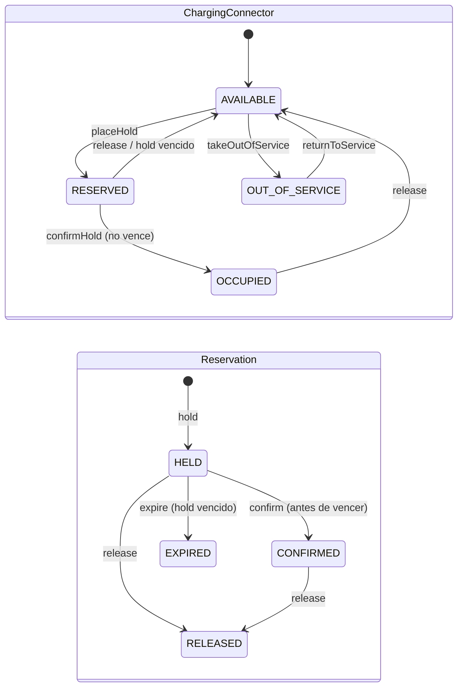
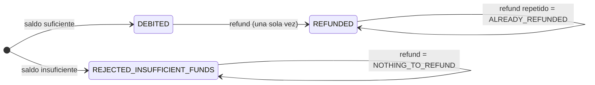
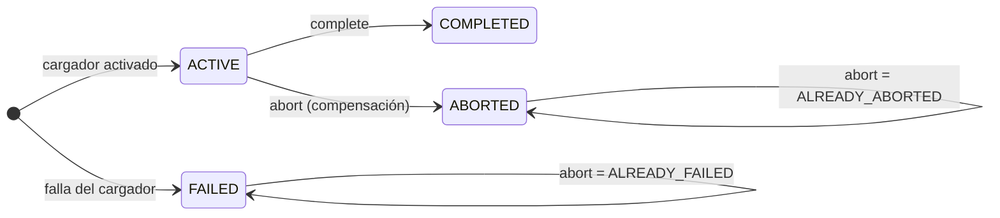

# 10 · Modelo de dominio por bounded context

Implementación de los conceptos del dominio ([ADR-0020](../adr/0020-modelos-de-dominio-y-contratos-zod.md)). Cada contexto vive en el `src/domain/` de **su** servicio, en TypeScript puro: sin Zod, sin el SDK de AWS y sin paquetes del workspace. dependency-cruiser hace cumplir esta regla. No hay un dominio compartido: los identificadores y Value Objects que se repiten entre contextos (p. ej. `SagaId`, la energía en Wh) se definen por separado en cada uno.

Convenciones comunes de los cinco dominios:

- **Inmutabilidad:** las entidades tienen campos `readonly` y cada transición devuelve una instancia nueva.
- **Errores:** cada contexto tiene una clase base `DomainError` con un `code` estable; la capa HTTP lo traducirá al catálogo del contrato. `InvalidValueError` se usa para Value Objects inválidos.
- **Construcción:** con factorías (`create`, `hold`, `start`, `applied`…) para crear y `restore()` para reconstruir desde persistencia, validando invariantes.
- **Identificadores:** tipos *branded* (`StationId`, `SagaId`…) con `X.parse(raw)`, que valida el prefijo.
- **Tombstones:** son entidades separadas (`ReservationTombstone`, `DebitTombstone`, `SessionTombstone`), no un estado más de la entidad, porque un tombstone no tiene los términos de la petición original.
- **Lógica sin efectos:** los servicios de dominio son funciones puras que reciben el estado leído (o `undefined`) y devuelven el estado a persistir junto con un *outcome* explícito.

## Station Reservation (`services/station-reservation/src/domain`)

| Tipo | Elemento | Invariantes / reglas |
| --- | --- | --- |
| Entidad | **Station** | Nombre recortado de 1–120 caracteres; ciudad y ubicación válidas. Solo datos de catálogo. |
| Agregado | **ChargingConnector** | Estados `AVAILABLE`, `RESERVED` (bloqueo temporal), `OCCUPIED` (carga en curso) y `OUT_OF_SERVICE` (avería o mantenimiento). Existe `hold` ⇔ `RESERVED` u `OCCUPIED`. Un `RESERVED` vencido se ve disponible (vencimiento perezoso, `effectiveStatusAt`); un `OCCUPIED` no vence. `release` de otra reserva no hace nada. No se saca de servicio con una reserva vigente. |
| Agregado | **Reservation** | Términos inmutables (`sagaId`, `fleetId`, `stationId`, `connectorId`, `fastChargeBoost`) usados para la idempotencia; `RELEASED` exige `releaseReason`. Solo la SAGA dueña la confirma o libera (`RESERVATION_MISMATCH`). Un `HELD` vencido se informa `EXPIRED`. |
| Entidad | ReservationTombstone | Bloquea un `PUT` tardío con un id ya compensado. |
| Value Objects | `GeoLocation`, `City` (slug), `PowerKw` (> 0, ≤ 1000; ultra-carga ≥ 150 kW), `ConnectorType` | |
| Política | `ReservationPolicy` | *Hold* de 120 s, o 300 s con *boost*. *Boost* con la flag apagada → `FAST_CHARGE_BOOST_DISABLED`. Ultra-carga sin *boost* → `ULTRA_FAST_REQUIRES_BOOST` (P-14). |
| Servicios | `holdConnector`, `releaseReservation`, `confirmReservation` | |
| Errores | `CONNECTOR_UNAVAILABLE`, `FAST_CHARGE_BOOST_DISABLED`, `ULTRA_FAST_REQUIRES_BOOST`, `RESERVATION_CANCELLED`, `RESERVATION_NOT_HELD`, `RESERVATION_HOLD_EXPIRED`, `RESERVATION_MISMATCH`, `IDEMPOTENCY_CONFLICT`, `INVALID_VALUE` | |

Persistencia, concurrencia y expiración del servicio: [ADR-0021](../adr/0021-station-reservation-concurrencia-idempotencia-expiracion.md).

## Billing & Wallet (`services/billing-wallet/src/domain`)

| Tipo | Elemento | Invariantes / reglas |
| --- | --- | --- |
| Agregado | **Wallet** | Saldo ≥ 0 y moneda fija. `debit` sin saldo suficiente → `INSUFFICIENT_FUNDS`; importes de 0 rechazados. |
| Entidad | **WalletTransaction** | Libro mayor *append-only*: importe > 0 en la misma moneda que el saldo resultante. `DEBIT`/`REFUND` referencian `sagaId` + `debitId`; `TOP_UP` referencia `topUpId`. |
| Agregado | **Debit** | Términos inmutables para la idempotencia; el rechazo por fondos se persiste para responder igual en el reintento. |
| Entidad | DebitTombstone | Bloquea un cobro tardío con un id ya compensado. |
| Value Objects | `Money` (unidades menores enteras, ISO 4217, nunca negativo, no mezcla monedas), `Energy` (Wh enteros, ≤ 500 kWh) | |
| Política | `PricingPolicy` | Importe = tarifa por clase de potencia × energía × *surge*, aplicado solo con la flag activa y en hora pico local. Se calcula con `BigInt` y redondeo half-up. |
| Servicios | `debitEstimatedCharge` (`DEBITED` \| `REJECTED_INSUFFICIENT_FUNDS` \| `REPLAYED`), `refundDebit` (`REFUNDED` \| `ALREADY_REFUNDED` \| `NOTHING_TO_REFUND` \| `VOIDED`), `topUpWallet` | |
| Errores | `INSUFFICIENT_FUNDS`, `CURRENCY_MISMATCH`, `DEBIT_VOIDED`, `IDEMPOTENCY_CONFLICT`, `INVALID_DEBIT_TRANSITION`, `INVALID_VALUE` | |

## Energy Dispatch (`services/energy-dispatch/src/domain`)

| Tipo | Elemento | Invariantes / reglas |
| --- | --- | --- |
| Agregado | **ChargingSession** | `FAILED` ⇔ tiene `fault`. Estados terminales ⇔ tiene `endedAt`. Solo `ACTIVE` acepta telemetría y puede completarse. Una carga `COMPLETED` no puede abortarse (`SESSION_ALREADY_COMPLETED`). |
| Entidad | **TelemetryRecord** | Rangos físicos (0–1000 kW, 0–500 kWh, 0–1500 V, −40–120 °C). Respecto de la lectura anterior: tiempo estrictamente creciente y energía no decreciente. No anterior al inicio de la sesión ni mayor que la energía solicitada. |
| Entidad | SessionTombstone | Bloquea una activación tardía de una sesión ya abortada. |
| Value Objects | `RequestedEnergy` (Wh), `ChargerFault` (`E-XX-000`, `simulated`) | |
| Servicios | `startSession` (con el resultado del cargador: `ACTIVATED` o `FAULT`), `ensureCanStart`, `abortSession` | |
| Errores | `SESSION_ABORTED`, `SESSION_ALREADY_COMPLETED`, `SESSION_NOT_ACTIVE`, `IDEMPOTENCY_CONFLICT`, `TELEMETRY_OUT_OF_ORDER`, `INVALID_VALUE` | |

La flag `SIMULATE_CHARGER_HARDWARE_FAULT` **no** está en el dominio. La evaluará el adaptador `SimulatedChargerGateway`, que devolverá `{ kind: 'FAULT', fault: ChargerFault.simulatedHardwareFault() }`. El dominio solo registra el resultado.

## Charging Orchestration (`services/saga-orchestrator/src/domain`)

| Tipo | Elemento | Invariantes / reglas |
| --- | --- | --- |
| Agregado | **SagaTransaction** | Máquina de estados de [02-saga.md](02-saga.md). Ids de recursos pre-generados al crearse. Cada transición valida el estado de origen y añade eventos con secuencia continua. El plan de compensación se fija al empezar a compensar y se ejecuta en orden. Una SAGA terminal no programa reintentos. `COMPENSATION_PENDING` exige `nextAttemptAt`. |
| Value Objects | `CorrelationId` (UUID), ids *branded*, `RetryPolicy` | |
| Funciones | `compensationPlanFor(paso, resultadoConocido)`, `isTransientFailure` | |
| Errores | `INVALID_SAGA_TRANSITION`, `INVALID_VALUE` | |

Operaciones del agregado:

| Fase | Operaciones |
| --- | --- |
| Avance | `beginReservation`, `completeCurrentStep`, `recordAttemptFailure` |
| Fallo de un paso | `rejectCurrentStep` (rechazo de negocio), `abandonCurrentStep` (resultado desconocido) |
| Compensación | `compensationSucceeded`, `compensationFailed`, `resumeCompensation` |
| Recuperación | `markRecovered`, `isDueForRecovery`, `exceedsForwardDeadline` |

| Paso fallido | Rechazo de negocio (sin efecto) | Abandono técnico (efecto desconocido) | Estado final |
| --- | --- | --- | --- |
| RESERVATION | — (FAILED directo) | release | FAILED |
| DEBIT | release | refund → release | COMPENSATED |
| ACTIVATION | abort → refund → release | abort → refund → release | COMPENSATED |
| CONFIRMATION | no aplica (pivote superado) | — | REQUIRES_ATTENTION |

El diagrama de estados de la SAGA está en [02-saga.md](02-saga.md#7-máquina-de-estados-persistente).

## Platform Configuration (`apps/graphql-api/src/domain`)

| Tipo | Elemento | Invariantes / reglas |
| --- | --- | --- |
| Entidad | **FeatureFlag** | Descripción de 1–280 caracteres. `version` ≥ 1 y sube en cada cambio efectivo. `setEnabled` con el mismo valor no produce cambio ni auditoría. |
| Value Objects | `FeatureFlagKey` (`MAYÚSCULAS_CON_GUIONES_BAJOS`), `ActorId` | |
| Registro | `FlagChange` | Auditoría (`from`, `to`, `version`, `changedBy`, `changedAt`). |

El ambiente no es un atributo de la flag: cada ambiente tiene su propia tabla ([ADR-0007](../adr/0007-feature-flags-dynamodb-por-ambiente.md)).

## Correspondencia con los conceptos pedidos

| Concepto | Implementación |
| --- | --- |
| Station | `Station` (station-reservation) |
| ChargingConnector | `ChargingConnector` (station-reservation) |
| Reservation | `Reservation` + `ReservationTombstone` (station-reservation) |
| Wallet | `Wallet` (billing-wallet) |
| WalletTransaction | `WalletTransaction` (billing-wallet); el cargo de la SAGA es `Debit` |
| ChargingSession | `ChargingSession` + `SessionTombstone` (energy-dispatch) |
| TelemetryRecord | `TelemetryRecord` (energy-dispatch) |
| SagaTransaction | `SagaTransaction` (saga-orchestrator) |
| FeatureFlag | `FeatureFlag` (graphql-api); contrato de lectura en `featureFlagsV1` |
