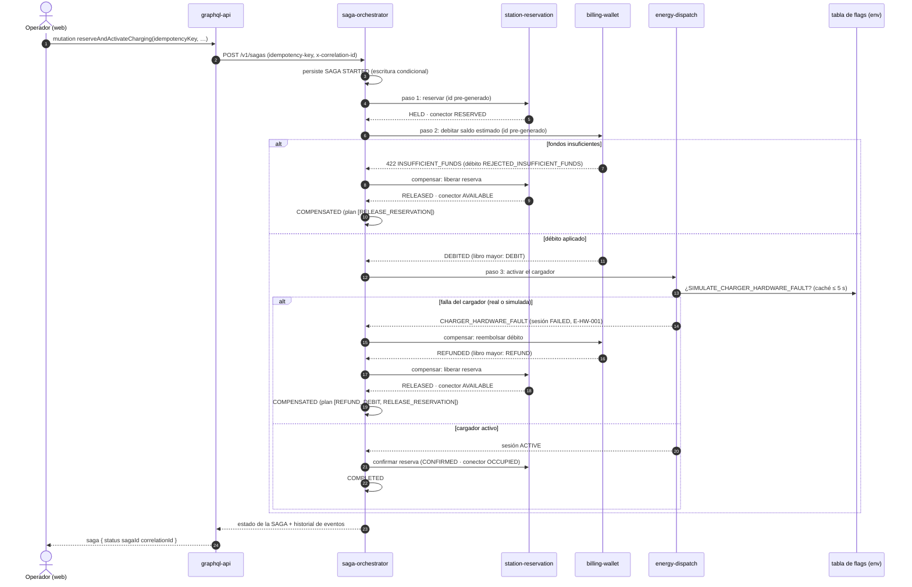
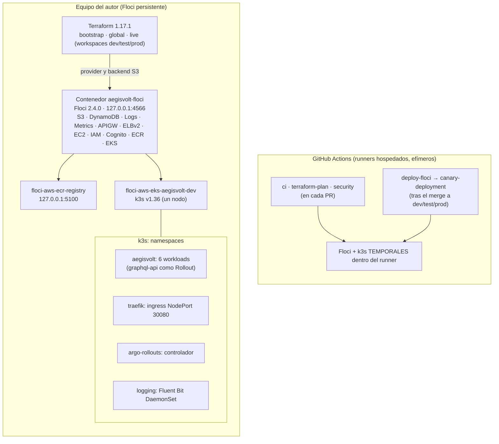
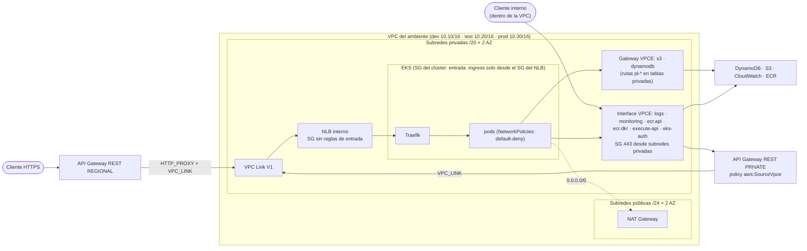

# Visión general de la arquitectura

Resumen de lo **implementado** en AegisVolt, con cuatro diagramas: arquitectura lógica, secuencia de la SAGA, despliegue y networking. El detalle está en los documentos [01–10](README.md) y en los [ADR](../adr/). Cada diagrama separa lo que en Floci se **ejecuta** de lo que solo se **declara** (metadatos), y remite a [limitations.md](../limitations.md).

## 1. Qué es y qué resuelve

AegisVolt es una plataforma para que los operadores de flotas de vehículos eléctricos hagan cuatro cosas:

- reservar un conector de carga;
- pagar con el saldo de la flota;
- activar la carga;
- auditar la telemetría y las transacciones.

Funciona con tres ambientes aislados: `dev`, `test` y `prod` ([`proyecto_final.md`](../../proyecto_final.md) §1).

**Problema técnico central.** El flujo "Reservar y Activar Carga" modifica tres bases de datos de tres servicios distintos. No existe una transacción ACID que las cubra. Si el cargador falla después del cobro, el sistema tiene que devolver el dinero y liberar el conector, aunque un mensaje se repita o un proceso se reinicie. La respuesta es una **SAGA orquestada con compensaciones idempotentes**.

## 2. Componentes

| Unidad | Tecnología | Responsabilidad | Persistencia propia |
| --- | --- | --- | --- |
| `apps/web` | React 19, Apollo Client 4, Vite | Consola: estaciones, carga, transacciones, flags y observabilidad. Solo habla con `/graphql` | — |
| `apps/graphql-api` | Apollo Server 5 sobre Express | BFF: esquema único (14 queries y 4 mutaciones), JWT de Cognito, autorización por flota y rol, errores centralizados | Escribe solo la tabla de flags de **su** ambiente (administradores) |
| `services/saga-orchestrator` | Express, hexagonal | Máquina de estados de la SAGA, compensaciones, *lease* y recuperación | `aegisvolt-sagas-<env>` |
| `services/station-reservation` | Express, hexagonal | Estaciones, conectores y reservas (`RESERVED`/`AVAILABLE`) | `aegisvolt-reservations-<env>` |
| `services/billing-wallet` | Express, hexagonal | Billeteras, débitos, reembolsos y libro mayor | `aegisvolt-billing-<env>` |
| `services/energy-dispatch` | Express, hexagonal | Activación del cargador (simulado), falla inducida por flag y telemetría | `aegisvolt-dispatch-<env>` |
| `packages/*` | TypeScript | `contracts` (HTTP/OpenAPI), `logger` (JSON), `config` (zod) y `feature-flags` (lector con caché). Sin lógica de dominio | — |
| `prefect/` | Python 3.12, Prefect 3.9.0 | Salud de los tres ambientes y auditoría de la SAGA, de solo lectura por APIs | — |

Las flags viven en `aegisvolt-feature-flags-<env>`, una tabla por ambiente. La tabla de cada proceso se deriva de `APP_ENV` ([ADR-0025](../adr/0025-feature-flags-por-ambiente-catalogo-escritura-auditada.md)).

## 3. Diagrama de arquitectura (lógico)

```mermaid
flowchart TB
  user(["Operador de flota / administrador"])
  subgraph edge["Entrada"]
    apigw["API Gateway REST<br/>(REGIONAL + PRIVATE)"]
    traefik["Traefik (ingress)<br/>reparto por peso del canary"]
  end
  cognito["Cognito User Pool<br/>(JWT RS256)"]
  subgraph k8s["Clúster EKS del ambiente · namespace aegisvolt"]
    web["web (nginx + SPA)"]
    gql["graphql-api (BFF)<br/>Rollout stable / canary"]
    orch["saga-orchestrator-service"]
    res["station-reservation-service"]
    bil["billing-wallet-service"]
    dis["energy-dispatch-service"]
    fb["Fluent Bit (namespace logging)"]
  end
  subgraph ddb["DynamoDB · una tabla por servicio y ambiente"]
    tS[("aegisvolt-sagas-env")]
    tR[("aegisvolt-reservations-env")]
    tB[("aegisvolt-billing-env")]
    tD[("aegisvolt-dispatch-env")]
    tF[("aegisvolt-feature-flags-env")]
  end
  cw["CloudWatch Logs y Metrics<br/>/aegisvolt/env/servicio"]
  prefect["Prefect (flows de salud y auditoría)"]

  user -->|HTTPS| apigw --> traefik
  traefik -->|/| web
  traefik -->|/graphql| gql
  web -.->|login| cognito
  gql -.->|JWKS| cognito
  gql -->|HTTP + x-correlation-id| orch
  gql -->|consultas| res & bil & dis
  orch -->|paso 1 / liberar| res
  orch -->|paso 2 / reembolsar| bil
  orch -->|paso 3| dis
  orch --> tS
  res --> tR
  bil --> tB
  dis --> tD
  gql -->|lee y escribe (admin)| tF
  res & bil & dis -->|leen con caché| tF
  gql & orch & res & bil & dis -.->|stdout JSON| fb
  fb --> cw
  prefect -->|GET de solo lectura| orch & res & bil & dis
  prefect -->|métricas AegisVolt/Audit| cw
```

Reglas que el diagrama hace visibles:

- Ningún servicio lee la tabla de otro. Se comunican por HTTP con contratos explícitos ([ADR-0004](../adr/0004-comunicacion-sincrona-http-contratos-openapi.md)), y dependency-cruiser impide importar código de otro servicio (`pnpm lint:deps`).
- Los resolvers de graphql-api validan, delegan y mapean. Las reglas de negocio están en el dominio de cada servicio.
- El `correlation_id` entra por `x-correlation-id`, o lo genera graphql-api. Se propaga a todos los servicios, logs y registros ([ADR-0009](../adr/0009-propagacion-correlation-id-y-saga-id.md)).

## 4. Diagrama de secuencia de la SAGA "Reservar y Activar Carga"



**Garantías** ([02-saga.md](02-saga.md), [ADR-0005](../adr/0005-idempotencia-ids-pregenerados-y-tombstones.md), [ADR-0024](../adr/0024-saga-orquestada-implementacion-estados-lease-recuperacion.md)):

- **Persistencia antes y después de cada paso.** Cada transición queda en la tabla de SAGAs con un evento `EVT#…`.
- **Lease y recuperación.** Si el orquestador muere a mitad de un paso, otro proceso retoma la SAGA cuando vence el *lease* y repite el paso con el mismo identificador.
- **Idempotencia.** Los identificadores (`res_…`, `dbt_…`) se generan antes de llamar al servicio. Las escrituras son condicionales:
  - `attribute_not_exists(PK)` para crear;
  - `status = :debited AND version = :v` para reembolsar.
  
  Repetir una compensación responde `ALREADY_REFUNDED` o `ALREADY_RELEASED` sin mover saldo.
- **Compensación fallida.** Queda en `COMPENSATION_FAILED` con `nextAttemptAt`. Nunca se marca como compensada sin estarlo.

## 5. Diagrama de despliegue



| Pieza | Local (Floci persistente) | GitHub Actions | AWS real (objetivo, no desplegado) |
| --- | --- | --- | --- |
| Estado de Terraform | `s3://aegisvolt-tfstate` en Floci, versionado, `env:/<ws>/aegisvolt/terraform.tfstate` | Reconstruido en un Floci temporal en cada ejecución | Mismo diseño en S3 real con política evaluada |
| Clúster | EKS de Floci = k3s; solo `dev` encendido (L-11) | Un k3s temporal por ejecución, en el ambiente de la rama | EKS administrado por ambiente |
| Imágenes | ECR de Floci, etiqueta `sha-<commit>[-dirty-<epoch>]` | ECR temporal, etiqueta `sha-<commit>` | ECR real |
| Despliegue | `scripts/floci/k8s-deploy.sh <env>` | `deploy-floci.yml` + `canary-deployment.yml` | Igual al de CI, con credenciales por OIDC (no implementado) |

Lo que **no** existe: ningún despliegue en AWS real y ningún runner self-hosted. El Floci persistente del autor no recibe cambios desde GitHub ([ADR-0035](../adr/0035-cicd-github-actions-runners-hospedados-floci-efimero.md), L-15).

## 6. Diagrama de networking



**Qué se ejecuta en Floci y qué solo se declara** (verificado con `scripts/floci/network-verify.sh <env>`):

| Elemento | En Floci |
| --- | --- |
| API Gateway (HTTPS) → VPC Link → NLB → NodePort de k3s → Traefik → pod | **Funcional**: `POST /graphql` responde 200 con TLS verificado contra la CA local |
| NetworkPolicies (`default-deny-all` y permisos explícitos) | **Funcional** (kube-router de k3s): `k8s-verify.sh` prueba conexiones permitidas y bloqueadas |
| VPC, subredes, rutas, NAT, SG y VPCE | **Solo metadatos**: se crean y se describen, pero no enrutan ni filtran (L-01, L-14) |
| API PRIVATE + `aws:SourceVpce` | **Solo metadatos**: responde 200 desde el host (L-02) |
| Endpoint privado del API server de EKS | **Solo metadatos**: `kubectl` entra desde el host (L-03) |

Un VPCE **no** lleva tráfico desde API Gateway hacia los pods: ese camino es VPC Link → NLB. Los VPCE sirven para que el tráfico **desde** la VPC hacia servicios de AWS no salga a Internet ([04-networking.md](04-networking.md)).

## 7. Decisiones clave (ADR)

| Tema | Decisión | ADR |
| --- | --- | --- |
| Emulación | Floci 2.4.0 fijado por digest, credenciales ficticias | [0001](../adr/0001-floci-emulador-aws-local.md) |
| SAGA | Orquestada, con estados por hito, *lease* y recuperación | [0003](../adr/0003-saga-orquestada-maquina-estados-persistente.md), [0024](../adr/0024-saga-orquestada-implementacion-estados-lease-recuperacion.md) |
| Idempotencia | IDs pre-generados, escrituras condicionales y *tombstones* | [0005](../adr/0005-idempotencia-ids-pregenerados-y-tombstones.md) |
| Flags | Tabla DynamoDB por ambiente, escritura auditada | [0007](../adr/0007-feature-flags-dynamodb-por-ambiente.md), [0025](../adr/0025-feature-flags-por-ambiente-catalogo-escritura-auditada.md) |
| Red | API Gateway → VPC Link → NLB; VPCE con consumidor justificado | [0010](../adr/0010-red-apigw-vpc-link-nlb-y-vpce.md), [0034](../adr/0034-red-eks-api-gateway-terraform-floci.md) |
| IaC | Terraform modular, backend S3 con `use_lockfile`, workspaces | [0011](../adr/0011-terraform-workspaces-backend-s3-bootstrap.md), [0033](../adr/0033-terraform-modular-backend-s3-floci.md) |
| Canary | Argo Rollouts + Traefik + CloudWatch | [0032](../adr/0032-canary-argo-rollouts-traefik-cloudwatch.md) |
| Observabilidad | Logs JSON, Fluent Bit → CloudWatch, Prefect de solo lectura | [0028](../adr/0028-logging-estructurado-operation-errores-tipados.md), [0029](../adr/0029-cloudwatch-fluent-bit-log-groups-metricas.md), [0030](../adr/0030-prefect-auditoria-solo-lectura-por-apis.md) |
| CI/CD | Runners hospedados, Floci efímero, promoción lineal | [0035](../adr/0035-cicd-github-actions-runners-hospedados-floci-efimero.md) |
| Riesgos de seguridad aceptados | Tres hallazgos de Trivy en IaC, con excepción acotada y caducidad | [0036](../adr/0036-riesgos-trivy-aceptados-y-reversion-kms.md) |
